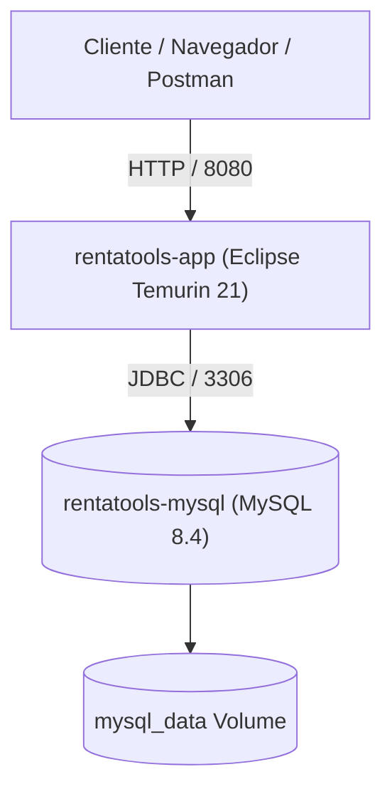

# Guía de Despliegue Dual — RentaTools

> Instrucciones formales para el despliegue del sistema RentaTools en dos modalidades:  
> 1. Despliegue en Contenedores con Docker y Docker Compose  
> 2. Despliegue con Servidor Apache Tomcat Embebido / Nativo

---

## 1. Variables de Entorno del Sistema

Para el despliegue en entornos de producción (`prod`), se deben configurar las siguientes variables de entorno:

| Variable de Entorno | Descripción | Valor por Defecto / Ejemplo | Obligatoria |
|---|---|---|:---:|
| `SPRING_PROFILES_ACTIVE` | Perfil de configuración activo de Spring Boot | `prod` | Sí |
| `SPRING_DATASOURCE_URL` | Cadena JDBC de conexión a la base de datos MySQL 8.4 | `jdbc:mysql://localhost:3306/rentatools?useUnicode=true&characterEncoding=utf8&connectionTimeZone=UTC&forceConnectionTimeZoneToSession=true` | Sí |
| `SPRING_DATASOURCE_USERNAME` | Usuario con permisos en la base de datos | `rentatools` | Sí |
| `SPRING_DATASOURCE_PASSWORD` | Contraseña del usuario de la base de datos | `rentatools` | Sí |
| `JWT_SECRET` | Llave secreta simétrica HS256 (mínimo 32 bytes / 256 bits) | `una-clave-secreta-altamente-segura-y-larga-para-produccion-1234` | Sí |
| `ADMIN_EMAIL` | Correo electrónico de la cuenta administradora inicial | `admin@rentatools.com` | No (opcional) |
| `ADMIN_PASSWORD` | Contraseña inicial para el usuario administrador | `Admin1234!` | No (opcional) |
| `PORT` | Puerto HTTP donde el servicio escuchará solicitudes | `8080` | No |
| `STORAGE_LOCATION` | Ruta del sistema de archivos donde se almacenan fotos y comprobantes | `/var/rentatools/uploads` o `./uploads` | No |
| `TZ` | Zona horaria del sistema operativo/contenedor | `UTC` | Sí |

---

## 2. Modalidad 1: Despliegue con Docker y Docker Compose

Esta modalidad orquesta tanto el motor de base de datos MySQL 8.4 como el contenedor de la aplicación empaquetada mediante `compose.yaml` y la imagen definida en `Dockerfile`.

### 2.1 Requisitos
- Docker Engine 24+ y Docker Compose v2.
- Puertos `3306` (MySQL) y `8080` (Aplicación) disponibles en la máquina anfitriona.

### 2.2 Arquitectura de Contenedores



### 2.3 Pasos para el Despliegue

1. **Clonar el repositorio y ubicarse en la raíz**:
   ```bash
   git clone https://github.com/castillokfirex/Proyecto_RentaHerramientas_kevin_castillo_daniel_gamboa.git
   cd Proyecto_RentaHerramientas_kevin_castillo_daniel_gamboa
   ```

2. **Levantar los contenedores enlazados**:
   ```bash
   docker compose up -d --build
   ```

3. **Verificar el estado de salud de los servicios**:
   ```bash
   docker compose ps
   ```
   Debe visualizarse:
   - `rentatools-mysql` en estado `healthy` (puerto `3306`).
   - `rentatools-app` en estado `running` (puerto `8080`).

4. **Monitorear los registros de arranque**:
   ```bash
   docker compose logs -f app
   ```
   Cuando observe `Started RentaToolsApplication in X seconds`, la aplicación estará lista para recibir tráfico.

5. **Parada y limpieza**:
   ```bash
   # Detener servicios
   docker compose down

   # Detener servicios eliminando volúmenes de datos si se requiere reiniciar la BD
   docker compose down -v
   ```

---

## 3. Modalidad 2: Despliegue con Apache Tomcat (Nativo / Embebido)

Spring Boot 3.5.x empaqueta por defecto un contenedor Apache Tomcat 10.1 optimizado de alto rendimiento para aplicaciones stateless con HTTP/1.1 y compresión gzip.

### 3.1 Requisitos
- Java 21 LTS instalado en el servidor.
- Instancia activa de MySQL 8.4 accesible en red con codificación `utf8mb4` e InnoDB.
- Carpeta de almacenamiento para archivos locales con permisos de lectura y escritura.

### 3.2 Preparación de la Base de Datos

En el servidor MySQL, asegure la existencia de la base de datos y usuario:

```sql
CREATE DATABASE IF NOT EXISTS rentatools
    CHARACTER SET utf8mb4
    COLLATE utf8mb4_0900_ai_ci;

CREATE USER IF NOT EXISTS 'rentatools'@'%' IDENTIFIED BY 'rentatools';
GRANT ALL PRIVILEGES ON rentatools.* TO 'rentatools'@'%';
FLUSH PRIVILEGES;
```

> [!NOTE]
> No es necesario ejecutar scripts DDL manualmente; Flyway ejecutará de forma automática y versionada las migraciones `V1` a `V5` (incluyendo los datos semilla) al arrancar el servicio.

### 3.3 Construcción del Artefacto de Producción

En el entorno de construcción:

```powershell
.\mvnw.cmd clean package -DskipTests
```

Copie el archivo generado `target/rentatools-0.0.1-SNAPSHOT.jar` al directorio de despliegue en el servidor, por ejemplo `/opt/rentatools/rentatools.jar` o `C:\rentatools\rentatools.jar`.

### 3.4 Arranque como Servicio de Sistema

#### En Linux (Systemd Service)
Cree el archivo `/etc/systemd/system/rentatools.service`:

```ini
[Unit]
Description=RentaTools Spring Boot Application
After=syslog.target network.target mysql.service

[Service]
User=rentatools
Group=rentatools
Type=simple
WorkingDirectory=/opt/rentatools
Environment="SPRING_PROFILES_ACTIVE=prod"
Environment="SPRING_DATASOURCE_URL=jdbc:mysql://127.0.0.1:3306/rentatools?useUnicode=true&characterEncoding=utf8&connectionTimeZone=UTC&forceConnectionTimeZoneToSession=true"
Environment="SPRING_DATASOURCE_USERNAME=rentatools"
Environment="SPRING_DATASOURCE_PASSWORD=rentatools"
Environment="JWT_SECRET=super-secreto-hs256-para-produccion-rentatools-32bytes"
Environment="ADMIN_EMAIL=admin@rentatools.com"
Environment="ADMIN_PASSWORD=Admin1234!"
Environment="PORT=8080"
Environment="TZ=UTC"
ExecStart=/usr/bin/java -Xms512m -Xmx1024m -jar /opt/rentatools/rentatools.jar
Restart=always
RestartSec=10

[Install]
WantedBy=multi-user.target
```

Habilite e inicie el servicio:
```bash
sudo systemctl daemon-reload
sudo systemctl enable rentatools
sudo systemctl start rentatools
sudo systemctl status rentatools
```

#### En Windows (PowerShell / Windows Service con NSSM)
Para arranque directo desde consola o script de inicio:

```powershell
$env:SPRING_PROFILES_ACTIVE = "prod"
$env:SPRING_DATASOURCE_URL = "jdbc:mysql://localhost:3306/rentatools?useUnicode=true&characterEncoding=utf8&connectionTimeZone=UTC&forceConnectionTimeZoneToSession=true"
$env:SPRING_DATASOURCE_USERNAME = "rentatools"
$env:SPRING_DATASOURCE_PASSWORD = "rentatools"
$env:JWT_SECRET = "super-secreto-hs256-para-produccion-rentatools-32bytes"
$env:PORT = "8080"
$env:TZ = "UTC"

java -Xms512m -Xmx1024m -jar target\rentatools-0.0.1-SNAPSHOT.jar
```

---

## 4. Verificación Post-Despliegue

1. **Prueba de Conectividad HTTP**:
   ```bash
   curl -I http://localhost:8080/swagger-ui.html
   ```
   Debe retornar HTTP `200 OK` o `302 Found`.

2. **Acceso a la Interfaz de Pruebas**:
   Abra en su navegador `http://localhost:8080/swagger-ui.html`.

3. **Prueba de Autenticación de Administrador**:
   ```bash
   curl -X POST http://localhost:8080/api/v1/auth/login \
     -H "Content-Type: application/json" \
     -d '{"email":"admin@rentatools.com","password":"Admin1234!"}'
   ```
   Debe retornar un objeto JSON con `accessToken` y `refreshToken`.
