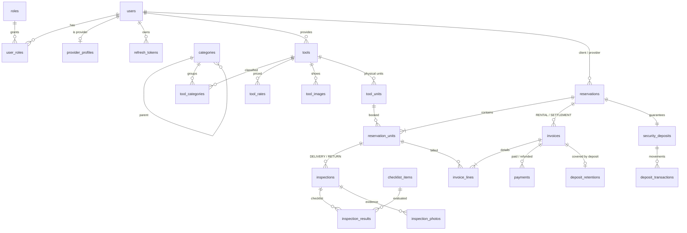

# RentaTools — Esquema MySQL normalizado (3FN → FNBC → 4FN)

> Destino en el repo: `docs/arquitectura/DDL-4FN.md` y `src/main/resources/db/migration/V1..V4__*.sql`

## 1. Convenciones

| Tema | Decisión | Motivo |
|---|---|---|
| Motor | MySQL **8.0.16+** (recomendado 8.4 LTS), InnoDB, `utf8mb4_0900_ai_ci` | Los `CHECK` solo se aplican desde 8.0.16; el índice funcional requiere 8.0.13+ |
| Identificadores | `BINARY(16)` con **UUID v7**, generado en el dominio | El agregado tiene identidad antes de persistirse; v7 está ordenado por tiempo → inserciones secuenciales en el índice agrupado |
| Catálogos | Clave natural (`roles.code`) o `SMALLINT AUTO_INCREMENT` (`checklist_items`) | Datos de referencia pequeños |
| Dinero | `DECIMAL(12,2)`, **una sola moneda** configurable (`app.currency`) | Si guardáramos la moneda en cada fila, se repetiría el mismo valor en todas |
| Enumeraciones | `VARCHAR + CHECK` | Se mapea directo con `EnumType.STRING` |
| Concurrencia | Columna `version` en las raíces de agregado | Bloqueo optimista de JPA |
| Fechas/horas | `DATETIME(6)` en UTC; `DATE` para los rangos de alquiler | `hibernate.jdbc.time_zone=UTC` |
| FK entre contextos | **Sí existen en la BD**, pero en JPA son columnas `UUID` sueltas (sin `@ManyToOne` entre módulos) | Integridad en la BD sin acoplar el código |
| Borrado | `ON DELETE CASCADE` solo en tablas hijas que forman parte del mismo agregado; en el resto, `RESTRICT` (lo que MySQL usa por defecto) | Nunca se borran usuarios, reservas ni facturas |

---

## 2. Método de verificación (para que puedas comprobarlo tú)

**Definiciones que uso**

- **3FN**: para toda DF no trivial `X → A`, o `X` es superclave o `A` es primo (forma parte de alguna clave candidata).
- **FNBC**: para toda DF no trivial `X → A`, `X` es superclave.
- **4FN**: para toda DMV no trivial `X ↠ Y`, `X` es superclave. Una DMV `X ↠ Y` es trivial si `Y ⊆ X` o si `X ∪ Y` cubre toda la relación.

**Lema (Date–Fagin 1992):** *si una relación está en FNBC y tiene al menos una clave candidata de un solo atributo, entonces está en 4FN.*

Demostración: supón una DMV no trivial `X ↠ Y` con `X` que no es superclave, y sea `Z = R − X − Y` (no vacío). Sea `K` la clave simple; `K ∉ X`. Por complementación, podemos suponer `K ∈ Y`. Toma dos tuplas `t1, t2` con `t1[X] = t2[X]`. La DMV exige que exista `t3` con `t3[XY] = t1[XY]` y `t3[Z] = t2[Z]`. Como `t3[K] = t1[K]` y `K` es clave, `t3 = t1`, así que `t1[Z] = t2[Z]`. Eso significa que `X → Z`, con `X` sin ser superclave, lo que contradice la FNBC. ∎

> [!WARNING]
> **Las claves sustitutas engañan.** Por el lema, cualquier tabla con un `id` sustituto pasa la 4FN *formalmente*, aunque sea un mal diseño. Por ejemplo, `tool_details(id, tool_id, category_id, image_key)` está en 4FN gracias al `id` y aun así repite datos en producto cartesiano. Por eso **cada tabla se analiza sin su `id` sustituto, razonando sobre sus claves naturales.** Solo uso el lema con claves simples *naturales* o en tablas de eventos (pagos, movimientos), que no tienen clave natural.

En el análisis no se toman como violaciones las columnas que admiten `NULL` y dependen solo de la clave. Las restricciones de co-nulidad tipo `(a IS NULL) = (b IS NULL)` restringen valores; no son DF.

---

## 3. Diagrama ER



---

## 4. Scripts DDL (Flyway)

### V1__iam.sql

```sql
-- ============================================================
-- Bounded context: IAM
-- ============================================================
CREATE TABLE roles (
    code         VARCHAR(20)  NOT NULL,
    description  VARCHAR(100) NOT NULL,
    CONSTRAINT pk_roles      PRIMARY KEY (code),
    CONSTRAINT ck_roles_code CHECK (code IN ('ADMIN', 'PROVEEDOR', 'CLIENTE'))
);

INSERT INTO roles (code, description) VALUES
    ('ADMIN',     'Administrador de la plataforma'),
    ('PROVEEDOR', 'Proveedor que publica herramientas'),
    ('CLIENTE',   'Cliente que alquila herramientas');

CREATE TABLE users (
    id             BINARY(16)   NOT NULL,
    email          VARCHAR(254) NOT NULL,
    password_hash  VARCHAR(100) NOT NULL,
    full_name      VARCHAR(150) NOT NULL,
    phone          VARCHAR(20)  NULL,
    status         VARCHAR(20)  NOT NULL,
    created_at     DATETIME(6)  NOT NULL,
    updated_at     DATETIME(6)  NOT NULL,
    version        BIGINT       NOT NULL DEFAULT 0,
    CONSTRAINT pk_users        PRIMARY KEY (id),
    CONSTRAINT uq_users_email  UNIQUE (email),
    CONSTRAINT ck_users_status CHECK (status IN ('ACTIVE', 'SUSPENDED'))
);

CREATE TABLE user_roles (
    user_id    BINARY(16)  NOT NULL,
    role_code  VARCHAR(20) NOT NULL,
    CONSTRAINT pk_user_roles      PRIMARY KEY (user_id, role_code),
    CONSTRAINT fk_user_roles_user FOREIGN KEY (user_id)   REFERENCES users (id) ON DELETE CASCADE,
    CONSTRAINT fk_user_roles_role FOREIGN KEY (role_code) REFERENCES roles (code)
);

CREATE TABLE provider_profiles (
    user_id        BINARY(16)   NOT NULL,
    business_name  VARCHAR(150) NOT NULL,
    tax_id         VARCHAR(20)  NOT NULL,
    approved_at    DATETIME(6)  NULL,
    approved_by    BINARY(16)   NULL,
    CONSTRAINT pk_provider_profiles          PRIMARY KEY (user_id),
    CONSTRAINT uq_provider_profiles_tax_id   UNIQUE (tax_id),
    CONSTRAINT fk_provider_profiles_user     FOREIGN KEY (user_id)     REFERENCES users (id),
    CONSTRAINT fk_provider_profiles_approver FOREIGN KEY (approved_by) REFERENCES users (id),
    CONSTRAINT ck_provider_profiles_approval CHECK ((approved_at IS NULL) = (approved_by IS NULL))
);

CREATE TABLE refresh_tokens (
    id          BINARY(16)  NOT NULL,
    user_id     BINARY(16)  NOT NULL,
    token_hash  CHAR(64)    NOT NULL,          -- SHA-256 en hex; el token en claro nunca se guarda
    issued_at   DATETIME(6) NOT NULL,
    expires_at  DATETIME(6) NOT NULL,
    revoked_at  DATETIME(6) NULL,
    CONSTRAINT pk_refresh_tokens      PRIMARY KEY (id),
    CONSTRAINT uq_refresh_tokens_hash UNIQUE (token_hash),
    CONSTRAINT fk_refresh_tokens_user FOREIGN KEY (user_id) REFERENCES users (id) ON DELETE CASCADE,
    CONSTRAINT ck_refresh_tokens_exp  CHECK (expires_at > issued_at)
);
```

### V2__inventory.sql

```sql
-- ============================================================
-- Bounded context: INVENTORY
-- ============================================================
CREATE TABLE categories (
    id           BINARY(16)   NOT NULL,
    parent_id    BINARY(16)   NULL,
    name         VARCHAR(80)  NOT NULL,
    description  VARCHAR(500) NULL,
    active       BOOLEAN      NOT NULL DEFAULT TRUE,
    created_at   DATETIME(6)  NOT NULL,
    version      BIGINT       NOT NULL DEFAULT 0,
    CONSTRAINT pk_categories        PRIMARY KEY (id),
    CONSTRAINT fk_categories_parent FOREIGN KEY (parent_id) REFERENCES categories (id),
    CONSTRAINT ck_categories_name   CHECK (CHAR_LENGTH(TRIM(name)) > 0)
);
-- Nombre único entre categorías hermanas. Las raíces (parent_id NULL) se normalizan a un valor
-- centinela dentro del índice funcional porque UNIQUE trata cada NULL como distinto.
-- El centinela no se guarda como dato.
CREATE UNIQUE INDEX uq_categories_parent_name
    ON categories ((COALESCE(parent_id, 0x00000000000000000000000000000000)), name);

CREATE TABLE tools (
    id              BINARY(16)    NOT NULL,
    provider_id     BINARY(16)    NOT NULL,
    name            VARCHAR(150)  NOT NULL,
    brand           VARCHAR(80)   NULL,
    model           VARCHAR(80)   NULL,
    description     TEXT          NULL,
    deposit_amount  DECIMAL(12,2) NOT NULL,
    status          VARCHAR(20)   NOT NULL,
    created_at      DATETIME(6)   NOT NULL,
    updated_at      DATETIME(6)   NOT NULL,
    version         BIGINT        NOT NULL DEFAULT 0,
    CONSTRAINT pk_tools               PRIMARY KEY (id),
    CONSTRAINT uq_tools_provider_name UNIQUE (provider_id, name),
    CONSTRAINT fk_tools_provider      FOREIGN KEY (provider_id) REFERENCES users (id),
    CONSTRAINT ck_tools_deposit       CHECK (deposit_amount >= 0),
    CONSTRAINT ck_tools_status        CHECK (status IN ('DRAFT', 'ACTIVE', 'INACTIVE'))
);
CREATE INDEX ix_tools_status ON tools (status);
CREATE FULLTEXT INDEX ft_tools_search ON tools (name, brand, model, description);

CREATE TABLE tool_categories (
    tool_id      BINARY(16) NOT NULL,
    category_id  BINARY(16) NOT NULL,
    CONSTRAINT pk_tool_categories          PRIMARY KEY (tool_id, category_id),
    CONSTRAINT fk_tool_categories_tool     FOREIGN KEY (tool_id)     REFERENCES tools (id) ON DELETE CASCADE,
    CONSTRAINT fk_tool_categories_category FOREIGN KEY (category_id) REFERENCES categories (id)
);

CREATE TABLE tool_rates (
    tool_id  BINARY(16)    NOT NULL,
    period   VARCHAR(10)   NOT NULL,
    price    DECIMAL(12,2) NOT NULL,
    CONSTRAINT pk_tool_rates        PRIMARY KEY (tool_id, period),
    CONSTRAINT fk_tool_rates_tool   FOREIGN KEY (tool_id) REFERENCES tools (id) ON DELETE CASCADE,
    CONSTRAINT ck_tool_rates_period CHECK (period IN ('DAY', 'WEEK', 'MONTH')),
    CONSTRAINT ck_tool_rates_price  CHECK (price > 0)
);

CREATE TABLE tool_images (
    id            BINARY(16)        NOT NULL,
    tool_id       BINARY(16)        NOT NULL,
    storage_key   VARCHAR(255)      NOT NULL,
    content_type  VARCHAR(30)       NOT NULL,
    size_bytes    INT UNSIGNED      NOT NULL,
    position      SMALLINT UNSIGNED NOT NULL,   -- 0 = portada
    uploaded_at   DATETIME(6)       NOT NULL,
    CONSTRAINT pk_tool_images               PRIMARY KEY (id),
    CONSTRAINT uq_tool_images_storage_key   UNIQUE (storage_key),
    CONSTRAINT uq_tool_images_tool_position UNIQUE (tool_id, position),
    CONSTRAINT fk_tool_images_tool          FOREIGN KEY (tool_id) REFERENCES tools (id) ON DELETE CASCADE,
    CONSTRAINT ck_tool_images_type          CHECK (content_type IN ('image/jpeg', 'image/png', 'image/webp')),
    CONSTRAINT ck_tool_images_size          CHECK (size_bytes > 0 AND size_bytes <= 5242880)
);

CREATE TABLE tool_units (
    id             BINARY(16)   NOT NULL,
    tool_id        BINARY(16)   NOT NULL,
    serial_number  VARCHAR(80)  NOT NULL,
    status         VARCHAR(20)  NOT NULL,
    acquired_on    DATE         NULL,
    notes          VARCHAR(500) NULL,
    created_at     DATETIME(6)  NOT NULL,
    version        BIGINT       NOT NULL DEFAULT 0,
    CONSTRAINT pk_tool_units             PRIMARY KEY (id),
    CONSTRAINT uq_tool_units_tool_serial UNIQUE (tool_id, serial_number),
    CONSTRAINT fk_tool_units_tool        FOREIGN KEY (tool_id) REFERENCES tools (id),
    CONSTRAINT ck_tool_units_status      CHECK (status IN ('AVAILABLE', 'MAINTENANCE', 'RETIRED'))
);
CREATE INDEX ix_tool_units_tool_status ON tool_units (tool_id, status);
```

### V3__rental.sql

```sql
-- ============================================================
-- Bounded context: RENTAL
-- ============================================================
CREATE TABLE reservations (
    id             BINARY(16)   NOT NULL,
    code           CHAR(10)     NOT NULL,         -- base32 Crockford, para el usuario
    client_id      BINARY(16)   NOT NULL,
    provider_id    BINARY(16)   NOT NULL,
    start_date     DATE         NOT NULL,
    end_date       DATE         NOT NULL,         -- inclusivo
    status         VARCHAR(20)  NOT NULL,
    status_reason  VARCHAR(300) NULL,
    created_at     DATETIME(6)  NOT NULL,
    updated_at     DATETIME(6)  NOT NULL,
    version        BIGINT       NOT NULL DEFAULT 0,
    CONSTRAINT pk_reservations          PRIMARY KEY (id),
    CONSTRAINT uq_reservations_code     UNIQUE (code),
    CONSTRAINT fk_reservations_client   FOREIGN KEY (client_id)   REFERENCES users (id),
    CONSTRAINT fk_reservations_provider FOREIGN KEY (provider_id) REFERENCES users (id),
    CONSTRAINT ck_reservations_dates    CHECK (end_date >= start_date),
    CONSTRAINT ck_reservations_parties  CHECK (client_id <> provider_id),
    CONSTRAINT ck_reservations_status   CHECK (status IN ('PENDING', 'CONFIRMED', 'READY_FOR_PICKUP',
                                                          'ACTIVE', 'RETURNED', 'CLOSED',
                                                          'REJECTED', 'CANCELLED'))
);
CREATE INDEX ix_reservations_client   ON reservations (client_id, status);
CREATE INDEX ix_reservations_provider ON reservations (provider_id, status);
CREATE INDEX ix_reservations_dates    ON reservations (start_date, end_date);

CREATE TABLE reservation_units (
    id              BINARY(16)    NOT NULL,
    reservation_id  BINARY(16)    NOT NULL,
    unit_id         BINARY(16)    NOT NULL,
    daily_rate      DECIMAL(12,2) NOT NULL,   -- tarifa diaria pactada (base de la mora)
    agreed_amount   DECIMAL(12,2) NOT NULL,   -- importe pactado por el periodo completo
    deposit_amount  DECIMAL(12,2) NOT NULL,   -- garantía pactada por esta unidad
    CONSTRAINT pk_reservation_units             PRIMARY KEY (id),
    CONSTRAINT uq_reservation_units_res_unit    UNIQUE (reservation_id, unit_id),
    CONSTRAINT fk_reservation_units_reservation FOREIGN KEY (reservation_id) REFERENCES reservations (id) ON DELETE CASCADE,
    CONSTRAINT fk_reservation_units_unit        FOREIGN KEY (unit_id)        REFERENCES tool_units (id),
    CONSTRAINT ck_reservation_units_amounts     CHECK (daily_rate > 0 AND agreed_amount > 0 AND deposit_amount >= 0)
);
CREATE INDEX ix_reservation_units_unit ON reservation_units (unit_id);

CREATE TABLE checklist_items (
    id      SMALLINT UNSIGNED NOT NULL AUTO_INCREMENT,
    code    VARCHAR(40)       NOT NULL,
    label   VARCHAR(120)      NOT NULL,
    active  BOOLEAN           NOT NULL DEFAULT TRUE,
    CONSTRAINT pk_checklist_items      PRIMARY KEY (id),
    CONSTRAINT uq_checklist_items_code UNIQUE (code)
);

INSERT INTO checklist_items (code, label) VALUES
    ('CARCASA',        'Carcasa / estructura sin golpes ni fisuras'),
    ('CABLE_ENCHUFE',  'Cable, enchufe o batería en buen estado'),
    ('FUNCIONAMIENTO', 'Enciende y opera correctamente'),
    ('ACCESORIOS',     'Accesorios completos'),
    ('SEGURIDAD',      'Protecciones y dispositivos de seguridad'),
    ('LIMPIEZA',       'Limpieza general');

CREATE TABLE inspections (
    id                   BINARY(16)  NOT NULL,
    reservation_unit_id  BINARY(16)  NOT NULL,
    type                 VARCHAR(10) NOT NULL,
    inspector_id         BINARY(16)  NOT NULL,
    performed_at         DATETIME(6) NOT NULL,   -- hace de fecha de entrega / devolución
    overall_condition    VARCHAR(20) NOT NULL,
    observations         TEXT        NULL,
    CONSTRAINT pk_inspections           PRIMARY KEY (id),
    CONSTRAINT uq_inspections_unit_type UNIQUE (reservation_unit_id, type),
    CONSTRAINT fk_inspections_res_unit  FOREIGN KEY (reservation_unit_id) REFERENCES reservation_units (id),
    CONSTRAINT fk_inspections_inspector FOREIGN KEY (inspector_id)        REFERENCES users (id),
    CONSTRAINT ck_inspections_type      CHECK (type IN ('DELIVERY', 'RETURN')),
    CONSTRAINT ck_inspections_condition CHECK (overall_condition IN ('GOOD', 'MINOR_DAMAGE', 'MAJOR_DAMAGE', 'LOST')),
    CONSTRAINT ck_inspections_lost      CHECK (overall_condition <> 'LOST' OR type = 'RETURN')
);

CREATE TABLE inspection_results (
    inspection_id      BINARY(16)        NOT NULL,
    checklist_item_id  SMALLINT UNSIGNED NOT NULL,
    result             VARCHAR(15)       NOT NULL,
    note               VARCHAR(300)      NULL,
    CONSTRAINT pk_inspection_results            PRIMARY KEY (inspection_id, checklist_item_id),
    CONSTRAINT fk_inspection_results_inspection FOREIGN KEY (inspection_id)     REFERENCES inspections (id) ON DELETE CASCADE,
    CONSTRAINT fk_inspection_results_item       FOREIGN KEY (checklist_item_id) REFERENCES checklist_items (id),
    CONSTRAINT ck_inspection_results_result     CHECK (result IN ('OK', 'DAMAGED', 'MISSING', 'NOT_APPLICABLE'))
);

CREATE TABLE inspection_photos (
    id             BINARY(16)   NOT NULL,
    inspection_id  BINARY(16)   NOT NULL,
    storage_key    VARCHAR(255) NOT NULL,
    content_type   VARCHAR(30)  NOT NULL,
    size_bytes     INT UNSIGNED NOT NULL,
    uploaded_at    DATETIME(6)  NOT NULL,
    CONSTRAINT pk_inspection_photos            PRIMARY KEY (id),
    CONSTRAINT uq_inspection_photos_key        UNIQUE (storage_key),
    CONSTRAINT fk_inspection_photos_inspection FOREIGN KEY (inspection_id) REFERENCES inspections (id) ON DELETE CASCADE,
    CONSTRAINT ck_inspection_photos_type       CHECK (content_type IN ('image/jpeg', 'image/png', 'image/webp')),
    CONSTRAINT ck_inspection_photos_size       CHECK (size_bytes > 0 AND size_bytes <= 5242880)
);
```

### V4__billing.sql

```sql
-- ============================================================
-- Bounded context: BILLING
-- ============================================================
CREATE TABLE invoices (
    id              BINARY(16)      NOT NULL,
    reservation_id  BINARY(16)      NOT NULL,
    type            VARCHAR(20)     NOT NULL,
    number          BIGINT UNSIGNED NULL,      -- se asigna al emitir (MAX + 1, protegido por el UNIQUE)
    tax_rate        DECIMAL(5,4)    NOT NULL,  -- tasa vigente al crear la factura
    issued_at       DATETIME(6)     NULL,      -- NULL = borrador
    voided_at       DATETIME(6)     NULL,      -- NOT NULL = anulada
    created_at      DATETIME(6)     NOT NULL,
    version         BIGINT          NOT NULL DEFAULT 0,
    CONSTRAINT pk_invoices                  PRIMARY KEY (id),
    CONSTRAINT uq_invoices_number           UNIQUE (number),
    CONSTRAINT uq_invoices_reservation_type UNIQUE (reservation_id, type),
    CONSTRAINT fk_invoices_reservation      FOREIGN KEY (reservation_id) REFERENCES reservations (id),
    CONSTRAINT ck_invoices_type             CHECK (type IN ('RENTAL', 'SETTLEMENT')),
    CONSTRAINT ck_invoices_tax              CHECK (tax_rate >= 0 AND tax_rate < 1),
    CONSTRAINT ck_invoices_issue            CHECK ((number IS NULL) = (issued_at IS NULL)),
    CONSTRAINT ck_invoices_void             CHECK (voided_at IS NULL OR (issued_at IS NOT NULL AND voided_at >= issued_at))
);

CREATE TABLE invoice_lines (
    id                   BINARY(16)    NOT NULL,
    invoice_id           BINARY(16)    NOT NULL,
    reservation_unit_id  BINARY(16)    NOT NULL,
    concept              VARCHAR(10)   NOT NULL,
    description          VARCHAR(200)  NOT NULL,
    quantity             DECIMAL(10,2) NOT NULL,
    unit_price           DECIMAL(12,2) NOT NULL,
    CONSTRAINT pk_invoice_lines              PRIMARY KEY (id),
    CONSTRAINT uq_invoice_lines_unit_concept UNIQUE (reservation_unit_id, concept),
    CONSTRAINT fk_invoice_lines_invoice      FOREIGN KEY (invoice_id)          REFERENCES invoices (id) ON DELETE CASCADE,
    CONSTRAINT fk_invoice_lines_res_unit     FOREIGN KEY (reservation_unit_id) REFERENCES reservation_units (id),
    CONSTRAINT ck_invoice_lines_concept      CHECK (concept IN ('RENTAL', 'LATE_FEE', 'DAMAGE')),
    CONSTRAINT ck_invoice_lines_amounts      CHECK (quantity > 0 AND unit_price >= 0)
);
CREATE INDEX ix_invoice_lines_invoice ON invoice_lines (invoice_id);

CREATE TABLE payments (
    id           BINARY(16)    NOT NULL,
    invoice_id   BINARY(16)    NOT NULL,
    kind         VARCHAR(10)   NOT NULL,
    amount       DECIMAL(12,2) NOT NULL,
    method       VARCHAR(20)   NOT NULL,
    reference    VARCHAR(100)  NULL,
    occurred_at  DATETIME(6)   NOT NULL,
    recorded_by  BINARY(16)    NOT NULL,
    CONSTRAINT pk_payments             PRIMARY KEY (id),
    CONSTRAINT fk_payments_invoice     FOREIGN KEY (invoice_id)  REFERENCES invoices (id),
    CONSTRAINT fk_payments_recorded_by FOREIGN KEY (recorded_by) REFERENCES users (id),
    CONSTRAINT ck_payments_kind        CHECK (kind IN ('PAYMENT', 'REFUND')),
    CONSTRAINT ck_payments_amount      CHECK (amount > 0),
    CONSTRAINT ck_payments_method      CHECK (method IN ('CASH', 'CARD', 'TRANSFER', 'SIMULATED'))
);

CREATE TABLE security_deposits (
    id               BINARY(16)    NOT NULL,
    reservation_id   BINARY(16)    NOT NULL,
    required_amount  DECIMAL(12,2) NOT NULL,
    created_at       DATETIME(6)   NOT NULL,
    settled_at       DATETIME(6)   NULL,
    version          BIGINT        NOT NULL DEFAULT 0,
    CONSTRAINT pk_security_deposits             PRIMARY KEY (id),
    CONSTRAINT uq_security_deposits_reservation UNIQUE (reservation_id),
    CONSTRAINT fk_security_deposits_reservation FOREIGN KEY (reservation_id) REFERENCES reservations (id),
    CONSTRAINT ck_security_deposits_amount      CHECK (required_amount >= 0)
);

CREATE TABLE deposit_transactions (
    id           BINARY(16)    NOT NULL,
    deposit_id   BINARY(16)    NOT NULL,
    kind         VARCHAR(12)   NOT NULL,
    amount       DECIMAL(12,2) NOT NULL,
    method       VARCHAR(20)   NOT NULL,
    reference    VARCHAR(100)  NULL,
    occurred_at  DATETIME(6)   NOT NULL,
    recorded_by  BINARY(16)    NOT NULL,
    CONSTRAINT pk_deposit_transactions          PRIMARY KEY (id),
    CONSTRAINT fk_deposit_transactions_deposit  FOREIGN KEY (deposit_id)  REFERENCES security_deposits (id),
    CONSTRAINT fk_deposit_transactions_recorder FOREIGN KEY (recorded_by) REFERENCES users (id),
    CONSTRAINT ck_deposit_transactions_kind     CHECK (kind IN ('COLLECTION', 'REFUND')),
    CONSTRAINT ck_deposit_transactions_amount   CHECK (amount > 0),
    CONSTRAINT ck_deposit_transactions_method   CHECK (method IN ('CASH', 'CARD', 'TRANSFER', 'SIMULATED'))
);

CREATE TABLE deposit_retentions (
    invoice_id  BINARY(16)    NOT NULL,          -- factura SETTLEMENT cubierta con la garantía
    amount      DECIMAL(12,2) NOT NULL,
    applied_at  DATETIME(6)   NOT NULL,
    CONSTRAINT pk_deposit_retentions         PRIMARY KEY (invoice_id),
    CONSTRAINT fk_deposit_retentions_invoice FOREIGN KEY (invoice_id) REFERENCES invoices (id),
    CONSTRAINT ck_deposit_retentions_amount  CHECK (amount > 0)
);
```

---

## 5. Justificación tabla por tabla

Formato: **CC** = claves candidatas (sin contar el `id` sustituto, salvo que se diga lo contrario); **DF** = dependencias funcionales no triviales; **DMV** = dependencia multivaluada candidata (la que *podría* aparecer) y cómo la estructura la evita.

### IAM

#### `roles(code, description)`
- **CC**: `{code}`. **DF**: `code → description`.
- **3FN/FNBC**: el único determinante es la clave.
- **4FN**: tiene dos atributos y el determinante es clave, así que no puede haber DMV no trivial.

#### `users`
- **CC**: `{id}`, `{email}`. **DF**: `email → password_hash, full_name, phone, status, created_at, updated_at, version` (y lo mismo desde `id`).
- **3FN/FNBC**: no hay DF entre atributos no clave. No se guarda nada derivable, como edad a partir de la fecha de nacimiento o ciudad a partir del código postal.
- **4FN**: las DMV posibles son `usuario ↠ rol` y `usuario ↠ teléfono`. Si roles y teléfonos estuvieran en la misma tabla habría que guardar el producto cartesiano. Los roles están en `user_roles`. El teléfono es monovaluado por regla de negocio (un teléfono de contacto). Si algún día hicieran falta varios, irían a `user_phones`, **nunca** en la misma tabla que los roles.

#### `user_roles(user_id, role_code)`
- **CC**: `{user_id, role_code}` (toda la tabla es clave).
- **3FN/FNBC**: no hay atributos no clave.
- **4FN**: en una relación binaria, toda DMV `A ↠ B` es trivial porque `A ∪ B = R`. Esta tabla guarda **un solo** hecho multivaluado.

#### `provider_profiles`
- **CC**: `{user_id}`, `{tax_id}`. **DF**: `user_id → business_name, tax_id, approved_at, approved_by`; `tax_id → user_id`.
- **3FN/FNBC**: los dos determinantes son claves candidatas. No hay columna `status`: se sabe si está aprobado por `approved_at IS NOT NULL`. Si guardáramos un `status` aparte, aparecería la DF `approved_at → status`, cuyo determinante no es clave, y se rompería la FNBC.
- **4FN**: tiene una clave simple natural (`user_id`); por el lema, 4FN. Un proveedor con varias sucursales sería otro hecho multivaluado y necesitaría su propia tabla.

#### `refresh_tokens`
- **CC**: `{id}`, `{token_hash}`. **DF**: `token_hash → user_id, issued_at, expires_at, revoked_at`.
- **FNBC**: el `user_id` no determina nada (un usuario tiene varios tokens).
- **4FN**: clave simple natural `token_hash` ⇒ 4FN.

### INVENTORY

#### `categories`
- **CC**: `{id}`, `{parent_id, name}`; la unicidad de la segunda la garantiza el índice funcional, también para las raíces. **DF**: `(parent_id, name) → description, active, created_at`.
- **3FN/FNBC**: **no** hay `slug`. Un slug calculado desde `name` crearía la DF `name → slug`, y como `name` no es clave por sí solo se rompería la FNBC. Tampoco se guardan ruta ni profundidad, que se deducen recorriendo `parent_id`.
- **4FN**: `categoría ↠ herramienta` es un hecho multivaluado, pero vive en `tool_categories`, no aquí. La jerarquía es una relación N:1 (cada categoría tiene un padre), sin DMV.

#### `tools`
- **CC**: `{id}`, `{provider_id, name}`. **DF**: `(provider_id, name) → brand, model, description, deposit_amount, status, …`.
- **3FN/FNBC**:
  - `provider_id` no determina ningún atributo no clave: los datos del proveedor están en IAM.
  - ¿`(brand, model) → description`? **No**: una herramienta es *el anuncio de un proveedor*, no un producto de un catálogo global, y dos proveedores pueden describir el mismo modelo de forma distinta. Si se quisiera un catálogo global, se crearía una tabla `products`.
  - `status` es una decisión del proveedor (publicar o despublicar), no se calcula a partir de otras columnas.
- **4FN** — este es el caso clásico. Una herramienta tiene **cuatro** hechos multivaluados **independientes**: categorías, imágenes, tarifas y unidades. Contraejemplo de lo que se evita:

  | tool_id | category_id | image_key |
  |---|---|---|
  | T1 | Taladros | img1 |
  | T1 | Taladros | img2 |
  | T1 | Demolición | img1 |
  | T1 | Demolición | img2 |

  En esa tabla se cumple `tool_id ↠ category_id | image_key` sin que `tool_id` sea clave. Al añadir una imagen habría que insertar una fila por cada categoría (anomalía). La solución: **una tabla por cada hecho multivaluado** (`tool_categories`, `tool_images`, `tool_rates`, `tool_units`). En cada una, la única DMV es la trivial respecto de su clave.

#### `tool_categories(tool_id, category_id)`
- Toda la tabla es clave; es binaria ⇒ FNBC y 4FN sin más condiciones (mismo argumento que `user_roles`).

#### `tool_rates(tool_id, period, price)`
- **CC**: `{tool_id, period}`. **DF**: `(tool_id, period) → price`.
- **2FN**: ni `tool_id → price` ni `period → price` (el precio depende del par).
- **4FN**: ¿`tool_id ↠ period`? Solo valdría si `price` fuera independiente de `period`. No lo es: cada precio corresponde a un periodo concreto. Así que esa DMV no se cumple, y la clave es compuesta y mínima.
- *Diseño evitado*: columnas `price_day, price_week, price_month` en `tools`. Sería un grupo repetitivo disfrazado, con `NULL` cuando falta un periodo, y obligaría a cambiar el esquema si se añade `HOUR`.

#### `tool_images`
- **CC**: `{id}`, `{storage_key}`, `{tool_id, position}`. **DF**: `storage_key → tool_id, content_type, size_bytes, position, uploaded_at`; `(tool_id, position) → storage_key, …`.
- **FNBC**: todos los determinantes son claves candidatas. Aunque `content_type` pueda deducirse de la extensión de `storage_key`, eso no rompe nada porque `storage_key` es clave. La portada es `position = 0`; no hay columna `is_cover`, que crearía `position → is_cover`.
- **4FN**: clave simple natural `storage_key` ⇒ 4FN por el lema.

#### `tool_units`
- **CC**: `{id}`, `{tool_id, serial_number}`. **DF**: `(tool_id, serial_number) → status, acquired_on, notes, created_at`.
- **2FN — ejemplo concreto de lo que se evitó**: **no** se guarda `provider_id`. Se cumple `tool_id → provider_id`, y `tool_id` es solo una parte de la clave natural: sería una **dependencia parcial** y la tabla dejaría de estar en 2FN.
- **3FN**: `status` solo toma valores operativos (`AVAILABLE / MAINTENANCE / RETIRED`). **No existe `RENTED`**: que una unidad esté alquilada se deduce de `reservation_units` + `inspections`; guardarlo duplicaría un hecho de otra tabla y podría quedar inconsistente.
- **4FN**: la unidad no tiene hechos multivaluados en esta tabla; su historial de reservas está en `reservation_units`.

### RENTAL

#### `reservations`
- **CC**: `{id}`, `{code}`. **DF**: `code → client_id, provider_id, start_date, end_date, status, status_reason, …`.
- **3FN/FNBC**: `client_id` no determina nada (un cliente tiene muchas reservas), y lo mismo `provider_id`. Las fechas no determinan el estado.
  - `status` **no** se calcula a partir de columnas de esta tabla: las transiciones son decisiones (confirmar, rechazar, cancelar) o reacciones a eventos, y no se guardan marcas de tiempo por transición. Por eso no hay DF `X → status` con `X` no clave.
  - `provider_id` es una redundancia **entre tablas**, no dentro de esta. Se explica en §7.
- **4FN**: `reserva ↠ unidad` y `reserva ↠ inspección` están en tablas propias. Las fechas son un único rango por reserva (regla acordada), así que `reserva ↠ rango` no existe.

#### `reservation_units`
- **CC**: `{id}`, `{reservation_id, unit_id}`. **DF**: `(reservation_id, unit_id) → daily_rate, agreed_amount, deposit_amount`.
- **2FN, comprobada atributo por atributo**:
  - `reservation_id → daily_rate`? No: dos unidades de la misma reserva pueden tener precios distintos.
  - `unit_id → daily_rate`? No: la misma unidad tiene precios distintos en reservas distintas.
  - **No** se guarda `tool_id` (`unit_id → tool_id` sería parcial) ni las fechas o el cliente (`reservation_id → …` sería parcial).
- **3FN**: `agreed_amount` **no** se puede deducir de `daily_rate` más las fechas, porque se calcula con las tarifas semanal y mensual *de ese momento*, que no se guardan. Es el importe pactado, un hecho propio.
- **Regla de negocio explícita**: el precio se pacta **por unidad** (permite descuentos por unidad). Si el negocio exigiera "mismo precio para todas las unidades de una herramienta en una reserva", aparecería la DF `(reservation_id, tool_id) → daily_rate` y habría que sacar una tabla `reservation_items`.
- **4FN**: no hay hechos multivaluados; las inspecciones de la línea están en `inspections`.

#### `checklist_items`
- **CC**: `{id}`, `{code}`. **DF**: `code → label, active`. FNBC y 4FN (clave simple natural).

#### `inspections`
- **CC**: `{id}`, `{reservation_unit_id, type}` (como máximo una inspección de entrega y una de devolución por unidad). **DF**: `(reservation_unit_id, type) → inspector_id, performed_at, overall_condition, observations`.
- **3FN/FNBC**:
  - `inspector_id` no determina nada.
  - `overall_condition` es el **dictamen del inspector**, no una función de los resultados del checklist. Entre ambos solo hay una *restricción* (si algún ítem es `DAMAGED/MISSING`, el dictamen no puede ser `GOOD`), y se valida en el dominio.
  - `reservation_units` no guarda `delivered_at/returned_at`: esos momentos son `performed_at` de las inspecciones, así se evita duplicar el mismo hecho.
- **4FN** — el otro caso clásico. Una inspección tiene **dos** hechos multivaluados independientes: resultados del checklist y fotos. Contraejemplo evitado:

  | inspection_id | checklist_item | result | photo_key |
  |---|---|---|---|
  | I1 | CARCASA | DAMAGED | p1 |
  | I1 | CARCASA | DAMAGED | p2 |
  | I1 | CABLE | OK | p1 |
  | I1 | CABLE | OK | p2 |

  Ahí se cumple `inspection_id ↠ (checklist_item, result) | photo_key`. Se separa en `inspection_results` e `inspection_photos`. Las fotos son del conjunto de la inspección, no de un ítem; si algún día se ligaran a un ítem, la foto dependería del ítem y ya no serían hechos independientes.

#### `inspection_results(inspection_id, checklist_item_id, result, note)`
- **CC**: `{inspection_id, checklist_item_id}`. **DF**: `(inspection_id, checklist_item_id) → result, note`.
- **2FN**: `inspection_id → result`? No. `checklist_item_id → result`? No.
- **4FN**: `inspection_id ↠ checklist_item_id` exigiría que `result` fuera independiente del ítem, y no lo es. No hay DMV no trivial.

#### `inspection_photos`
- **CC**: `{id}`, `{storage_key}`. **DF**: `storage_key → inspection_id, content_type, size_bytes, uploaded_at`. FNBC; clave simple natural ⇒ 4FN.

### BILLING

#### `invoices`
- **CC**: `{id}`, `{reservation_id, type}`, y `{number}` cuando no es nulo. **DF**: `(reservation_id, type) → number, tax_rate, issued_at, voided_at, created_at`.
- **3FN/FNBC — dos columnas que se quitaron a propósito**:
  1. **No hay `client_id`**. Una reserva puede tener dos facturas (RENTAL y SETTLEMENT), así que `reservation_id` no es clave de esta tabla, y aun así se cumpliría `reservation_id → client_id`. Sería una **dependencia transitiva** (`id → reservation_id → client_id`) y se rompería la 3FN. El cliente se obtiene a través de la reserva.
  2. **No hay `status`**. El estado se deduce: `issued_at IS NULL` ⇒ borrador; `voided_at IS NOT NULL` ⇒ anulada; si no, emitida. Guardarlo crearía `{issued_at, voided_at} → status`, con un determinante que no es clave. "Pagada" tampoco se guarda: se calcula con pagos y retención.
  - Tampoco se guardan los totales: `subtotal = Σ(quantity × unit_price)`, `tax = subtotal × tax_rate`.
- **4FN**: `factura ↠ línea` y `factura ↠ pago` son hechos independientes, cada uno en su propia tabla (`invoice_lines`, `payments`).

#### `invoice_lines`
- **CC**: `{id}`, `{reservation_unit_id, concept}`. Cada unidad se factura una sola vez por concepto: el alquiler va solo en la factura RENTAL, y la mora y los daños solo en la SETTLEMENT (regla del dominio). **DF**: `(reservation_unit_id, concept) → invoice_id, description, quantity, unit_price`.
- **FNBC**: también se cumple `(reservation_unit_id, concept) → invoice_id`, pero su determinante es clave candidata, así que es válida. `invoice_id` por sí solo no determina nada. No se guarda el importe (`quantity × unit_price`, derivado). Tampoco se guarda `inspection_id` en las líneas de daño: se deduce de `(reservation_unit_id, 'RETURN')`, que es clave en `inspections`.
- **4FN**: ninguna línea tiene hechos multivaluados.

#### `payments`
- **CC**: solo `{id}`. Es una tabla de **eventos**: dos pagos idénticos al mismo tiempo son legítimos, así que no hay clave natural. **DF**: `id → invoice_id, kind, amount, method, reference, occurred_at, recorded_by`.
- **FNBC/4FN**: `invoice_id` no determina nada (hay varios pagos por factura). La clave simple es legítima porque no hay clave natural que ocultar ⇒ 4FN por el lema.
- No hay importes negativos: las devoluciones son filas `kind = 'REFUND'`.

#### `security_deposits`
- **CC**: `{id}`, `{reservation_id}`. **DF**: `reservation_id → required_amount, created_at, settled_at`.
- **3FN**: no hay `status` ni `balance`; ambos se calculan con los movimientos y retenciones (`saldo = Σ COLLECTION − Σ REFUND − Σ retenciones de las facturas de esa reserva`).
- **4FN**: `garantía ↠ movimiento` y `garantía ↠ retención` están en tablas separadas.

#### `deposit_transactions`
- Tabla de eventos, igual que `payments`: **CC** `{id}`; `deposit_id` no determina nada ⇒ FNBC/4FN.

#### `deposit_retentions(invoice_id, amount, applied_at)`
- **CC**: `{invoice_id}` (una retención como máximo por factura SETTLEMENT). **DF**: `invoice_id → amount, applied_at`.
- **3FN — se quitó `deposit_id`**: se cumple `invoice_id → reservation_id → deposit_id` (una garantía por reserva). Aunque dentro de esta tabla sería válido (el determinante es la clave), habría duplicado un hecho que ya está en otra tabla. Por eso la garantía se encuentra con `invoices.reservation_id = security_deposits.reservation_id`.
- **4FN**: binaria en la práctica, con clave simple ⇒ 4FN.

---

## 6. Columnas que se quitaron a propósito (resumen para revisar)

| Columna evitada | DF que habría creado | Forma normal que se rompería |
|---|---|---|
| `tool_units.provider_id` | `tool_id → provider_id` | 2FN (dependencia parcial) |
| `tool_units.status = RENTED` | se deduce de reservas + inspecciones | duplicación entre tablas |
| `categories.slug` | `name → slug` | FNBC |
| `provider_profiles.status` | `approved_at → status` | FNBC / 3FN |
| `invoices.client_id` | `reservation_id → client_id` | 3FN (transitiva) |
| `invoices.status`, `total`, `paid` | `{issued_at, voided_at} → status`; totales derivados | FNBC / 3FN |
| `reservation_units.tool_id`, fechas | `unit_id → tool_id`, `reservation_id → fechas` | 2FN |
| `reservation_units.delivered_at/returned_at` | duplica `inspections.performed_at` | duplicación entre tablas |
| `tool_images.is_cover` | `position → is_cover` | FNBC |
| `deposit_retentions.deposit_id` | `invoice_id → deposit_id` | duplicación entre tablas |
| Tabla de secuencia de facturas | `next_value = MAX(number) + 1` | duplicación entre tablas |

## 7. Redundancias entre tablas que sí se mantienen (no rompen ninguna forma normal)

Las formas normales se definen **dentro de cada relación**. Estas columnas tienen la clave como único determinante en su tabla, pero su valor coincide con datos de otras tablas. Las conservo a propósito:

| Columna | Por qué se conserva |
|---|---|
| `reservations.provider_id` | Coincide con `lines → unit → tool → provider`. Expresa la regla "un proveedor por reserva" y permite filtrar sin cuatro JOIN. No puede desincronizarse porque `tools.provider_id` es **inmutable** (el dominio no permite cambiarlo). *Alternativa purista: quitarla y deducirla por JOIN.* |
| `reservation_units.daily_rate / agreed_amount / deposit_amount` | **Foto histórica**. `tool_rates` cambia con el tiempo, así que el precio pactado no se puede deducir de los datos actuales. |
| `invoice_lines.quantity / unit_price` | Una factura es un documento legal inmutable. El importe facturado es un hecho distinto del pactado (podría corregirse). |
| `invoices.tax_rate` | Tasa vigente al emitir; la tasa configurada puede cambiar. |
| `security_deposits.required_amount` | Lo que billing exige como garantía; coincide con `Σ reservation_units.deposit_amount` al confirmar. Así billing es autónomo y no lee las tablas de rental. |

## 8. Reglas que no se pueden expresar en DDL (las garantiza el dominio)

1. **Sin solapamiento de una unidad entre reservas activas**: MySQL no tiene restricción de exclusión. Se hace con `SELECT … FOR UPDATE` sobre `tool_units` del `tool_id` y luego la consulta de solapamiento, todo en la misma transacción.
2. Todas las líneas de una reserva pertenecen a herramientas de `reservations.provider_id`.
3. Una inspección `RETURN` solo existe si antes hay una `DELIVERY` de esa línea, y su `performed_at` es posterior.
4. Si algún ítem del checklist está en `DAMAGED/MISSING`, `overall_condition` no puede ser `GOOD`.
5. Las líneas `RENTAL` van solo en facturas `RENTAL`; las `LATE_FEE/DAMAGE`, solo en `SETTLEMENT`. Las retenciones solo cubren facturas `SETTLEMENT`.
6. Lo pagado (pagos − devoluciones + retención) nunca supera el total de la factura.
7. Máximo 10 imágenes por herramienta y 10 fotos por inspección.
8. Una herramienta solo se publica (`ACTIVE`) si tiene tarifa `DAY`, al menos una unidad `AVAILABLE` y su proveedor está aprobado.
9. `categories` sin ciclos en `parent_id`.

> [!NOTE]
> Para reordenar `tool_images.position` respetando `UNIQUE(tool_id, position)`, el adaptador primero mueve las posiciones a un rango temporal (`position + 1000`) y luego asigna las definitivas, todo en la misma transacción.
