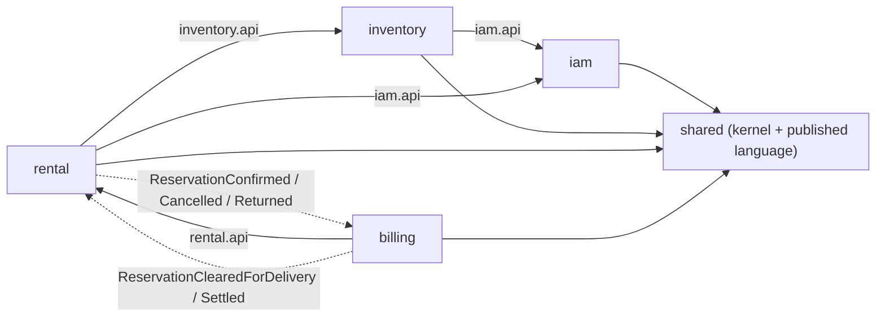
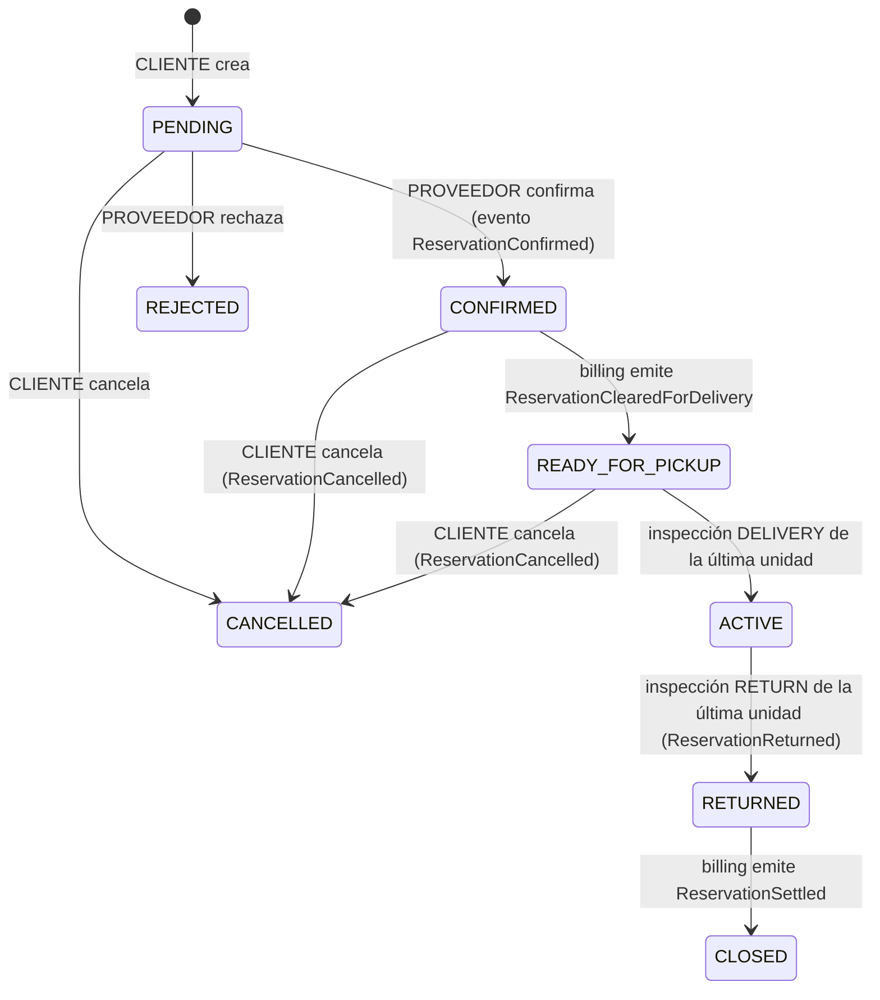
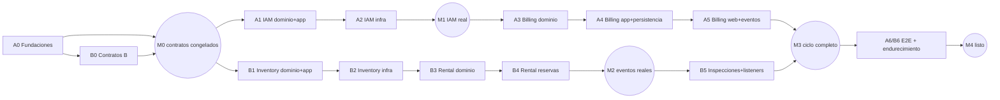

# RentaTools — Plan técnico de implementación

> Monolito modular · Arquitectura hexagonal · DDD · Spring Boot 3.5.x · Java 21 · MySQL 8 · JWT
> Destino en el repo: `docs/arquitectura/PLAN.md`. El esquema y su justificación están en [ddl_4fn.md](file:///C:/Users/kevic/.gemini/antigravity-ide/brain/4afac7ed-ff05-414d-bbb7-b6c77cc5dd64/ddl_4fn.md), destino `docs/arquitectura/DDL-4FN.md`.

---

## 0. Decisiones

| # | Decisión | Origen |
|---|---|---|
| 1 | Spring Boot **3.5.x** + Java 21 + Spring Security 6.5 | Tu respuesta |
| 2 | Solo API REST JSON con JWT; se elimina Thymeleaf | Tu respuesta |
| 3 | Inventario por **unidades físicas** (ficha `Tool` + N `ToolUnit` con número de serie) | Tu respuesta |
| 4 | Una reserva = varias unidades de **un solo proveedor** con **un solo rango de fechas** | Tu respuesta |
| 5 | Tarifas DAY/WEEK/MONTH + garantía por herramienta | Tu respuesta |
| 6 | Billing: factura RENTAL al confirmar y SETTLEMENT al cerrar; pagos simulados; mora y daños; cobro y devolución de garantía | Tu respuesta |
| 7 | Inspecciones de ENTREGA y DEVOLUCIÓN por unidad, con checklist, fotos y observaciones | Tu respuesta |
| 8 | Archivos en disco local detrás del puerto `FileStorage` | Tu respuesta |
| 9 | ArchUnit + Flyway (sin Spring Modulith) | Tu respuesta |
| 10 | Paquete base `com.rentatools`; A = shared + iam + billing, B = inventory + rental | Tu respuesta |
| 11 | **La capa application también es Java puro**. Los servicios se registran como beans por escaneo con filtro y las transacciones se declaran por AOP (sin `@Transactional` en el código de aplicación) | Propuesta mía |
| 12 | JWT con `spring-boot-starter-oauth2-resource-server` (Nimbus, HS256): se usa lo que trae Spring Security, sin filtro JWT hecho a mano | Propuesta mía |
| 13 | Comunicación entre contextos: **llamadas síncronas** a interfaces `<ctx>.api` (siempre desde un adaptador de infraestructura que actúa como capa anticorrupción) y **eventos de integración** en `shared.integration`, entregados en la **misma transacción** | Propuesta mía |
| 14 | FK físicas entre contextos en la BD; en JPA solo se guarda el UUID | Propuesta mía |
| 15 | Valores por defecto configurables: moneda `PEN`, IGV `0.18`, mora ×1.5, zona `America/Lima` | Propuesta mía (ajústalos) |
| 16 | **Postman es la prueba principal de los endpoints** (lo exige el enunciado). Los tests automáticos se quedan en dominio, persistencia y 6 flujos críticos (§9). Cada paso con endpoints entrega sus requests de Postman con scripts de test (§10) | Tu punto 5 |
| 17 | Reloj ajustable solo en el perfil `dev` (`PUT /api/v1/dev/clock`), para demostrar entregas y mora desde Postman sin esperar días reales | Propuesta mía (deriva del punto 5) |

> [!WARNING]
> **Spring Boot 3.5 dejó de tener soporte OSS el 30 de junio de 2026** (hoy es 14 de octubre de 2026). Ya no recibe parches de seguridad gratuitos. Yo te recomendé esta versión sin tenerlo en cuenta, y no fue correcto. Opciones:
> - **Mantener 3.5.x** si el curso o la rúbrica exigen "Spring Security 6". El plan está escrito para esta versión.
> - **Volver a Boot 4.x**, que es lo que ya tenía tu `pom.xml`. Trae Security 7, pero la API que usamos (`SecurityFilterChain`, resource server, `@PreAuthorize`) es casi igual. Cambian los starters (`spring-boot-starter-webmvc`, `spring-boot-starter-flyway`, starters de test modulares) y Jackson 3. La arquitectura, el DDL y las pistas **no cambian**.

---

## 1. Arquitectura

### 1.1 Dependencias entre módulos (sin ciclos)



Las flechas punteadas son eventos. Se definen en `shared.integration`, así que **billing y rental no se importan entre sí por los eventos**. La única dependencia directa es `billing → rental.api`, para consultar los participantes de una reserva.

### 1.2 Estructura hexagonal de cada contexto

```
<ctx>/
├── api/             ← contrato público para OTROS módulos (solo interfaces + records). Java puro.
├── domain/          ← modelo, VOs, servicios de dominio, eventos de dominio, excepciones. Java puro.
├── application/     ← puertos in (casos de uso), puertos out, servicios, DTOs. Java puro.
└── infrastructure/
    ├── adapter/in/web/      ← controllers REST + DTOs con Bean Validation
    ├── adapter/in/api/      ← implementación de <ctx>.api (delega en los casos de uso)
    ├── adapter/in/event/    ← listeners de eventos de integración
    ├── adapter/out/persistence/ ← @Entity, Spring Data, mappers, adaptadores de repositorio
    ├── adapter/out/<otroCtx>/   ← capa anticorrupción: implementa un puerto out llamando a <otroCtx>.api
    └── config/
```

### 1.3 Reglas que se comprueban con ArchUnit (`src/test/java/com/rentatools/architecture`)

1. `..domain..` no depende de `org.springframework..`, `jakarta..`, `org.hibernate..`, `com.fasterxml..`, `lombok..`, ni de `..application..` o `..infrastructure..`.
2. `..application..` no depende de `org.springframework..`, `jakarta..`, `org.hibernate..`, `..infrastructure..`.
3. `..api..` no depende de `org.springframework..` ni de `jakarta..`, y solo contiene interfaces, records y enums.
4. Una clase de `com.rentatools.X..` solo puede usar `com.rentatools.Y..` (con Y ≠ X, shared) si está en `Y.api..`, y **solo desde `X.infrastructure..`**.
5. `shared.domain`, `shared.application` y `shared.integration` pueden usarse desde cualquier capa; `shared.infrastructure` solo desde infraestructura.
6. Sin ciclos entre los slices `com.rentatools.(*)..`.
7. `@Entity` solo en `..adapter.out.persistence..`; `@RestController` solo en `..adapter.in.web..`.

### 1.4 Wiring y transacciones sin anotaciones de Spring en application

- `shared.infrastructure.config.ApplicationLayerScanConfig`: `@ComponentScan(basePackages = "com.rentatools", useDefaultFilters = false, includeFilters = @Filter(type = REGEX, pattern = "com\\.rentatools\\..*\\.(application\\.service|domain\\.service)\\..*"))`. Cada servicio tiene **un único constructor**, así que la inyección funciona sin anotaciones.
- `shared.infrastructure.config.UseCaseTransactionConfig`: un `Advisor` con `AspectJExpressionPointcut("execution(public * com.rentatools..application.service..*(..))")` y `TransactionInterceptor`. Los métodos `get*/find*/list*/search*/quote*` van en solo lectura; el resto, `REQUIRED` con rollback ante cualquier `Exception`.
- Eventos: `SpringIntegrationEventPublisher` delega en `ApplicationEventPublisher`. Los listeners usan `@EventListener` (síncrono, misma transacción). Si billing falla al recibir `ReservationConfirmed`, la confirmación entera hace rollback: hay **consistencia fuerte** sin outbox. Si en el futuro se separan los módulos: outbox + `@TransactionalEventListener`.

### 1.5 Concurrencia

- Bloqueo optimista con `version` en todas las raíces de agregado.
- Para evitar reservar dos veces la misma unidad, `UnitInventoryApi.lockOperationalUnits(toolId)` hace `SELECT … FOR UPDATE` sobre `tool_units`. Las reservas concurrentes de la **misma herramienta** se ejecutan en serie y luego se aplica la consulta de solapamiento.
- Número de factura: `MAX(number) + 1` en la transacción; si choca con `UNIQUE`, se reintenta hasta 3 veces.

---

## 2. Árbol de paquetes completo

```
demo/
├── pom.xml
├── compose.yaml                                  # MySQL 8.4 para desarrollo
├── .github/CODEOWNERS                            # shared/, *.api, db/migration, pom → revisión de ambos
├── postman/                                      # entregable del enunciado (§10)
│   ├── RentaTools.dev.postman_environment.json
│   ├── 00-flujo-completo.postman_collection.json
│   ├── 10-iam.postman_collection.json
│   ├── 20-inventory.postman_collection.json
│   ├── 30-rental.postman_collection.json
│   ├── 40-billing.postman_collection.json
│   ├── fixtures/ (taladro.jpg, danio.jpg, no-imagen.txt)
│   └── README.md
├── docs/arquitectura/
│   ├── PLAN.md
│   └── DDL-4FN.md
└── src/
    ├── main/
    │   ├── java/com/rentatools/
    │   │   ├── RentaToolsApplication.java
    │   │   │
    │   │   ├── shared/
    │   │   │   ├── domain/
    │   │   │   │   ├── AggregateRoot.java            # registerEvent / pullDomainEvents
    │   │   │   │   ├── DomainEvent.java
    │   │   │   │   ├── DomainException.java          # base: code + message
    │   │   │   │   ├── BusinessRuleViolation.java
    │   │   │   │   ├── Ids.java                      # UUID v7 en Java puro
    │   │   │   │   ├── Money.java
    │   │   │   │   ├── DateRange.java
    │   │   │   │   ├── Actor.java
    │   │   │   │   └── ActorRole.java
    │   │   │   ├── application/
    │   │   │   │   ├── PageQuery.java
    │   │   │   │   ├── PageResult.java
    │   │   │   │   ├── exception/
    │   │   │   │   │   ├── NotFoundException.java
    │   │   │   │   │   ├── ForbiddenException.java
    │   │   │   │   │   └── ConflictException.java
    │   │   │   │   └── port/out/
    │   │   │   │       ├── IntegrationEventPublisher.java
    │   │   │   │       ├── FileStorage.java
    │   │   │   │       └── StoredFile.java
    │   │   │   ├── integration/                      # published language (Java puro)
    │   │   │   │   ├── IntegrationEvent.java
    │   │   │   │   ├── rental/
    │   │   │   │   │   ├── ReservationConfirmed.java
    │   │   │   │   │   ├── ReservationCancelled.java
    │   │   │   │   │   └── ReservationReturned.java
    │   │   │   │   └── billing/
    │   │   │   │       ├── ReservationClearedForDelivery.java
    │   │   │   │       └── ReservationSettled.java
    │   │   │   └── infrastructure/
    │   │   │       ├── config/
    │   │   │       │   ├── ApplicationLayerScanConfig.java
    │   │   │       │   ├── UseCaseTransactionConfig.java
    │   │   │       │   ├── ClockConfig.java          # Clock con app.timezone
    │   │   │       │   ├── AppProperties.java
    │   │   │       │   └── OpenApiConfig.java
    │   │   │       ├── event/
    │   │   │       │   └── SpringIntegrationEventPublisher.java
    │   │   │       ├── dev/                          # @Profile("dev")
    │   │   │       │   ├── AdjustableClock.java
    │   │   │       │   └── DevClockController.java   # GET/PUT/DELETE /api/v1/dev/clock
    │   │   │       ├── storage/
    │   │   │       │   ├── LocalFileStorage.java
    │   │   │       │   └── StorageProperties.java
    │   │   │       ├── security/
    │   │   │       │   ├── SecurityConfig.java       # SecurityFilterChain, CORS, stateless, @EnableMethodSecurity
    │   │   │       │   ├── JwtConfig.java            # JwtEncoder/JwtDecoder HS256 + converter roles→ROLE_*
    │   │   │       │   ├── JwtProperties.java
    │   │   │       │   └── RestAuthErrorHandlers.java # 401/403 en formato ProblemDetail
    │   │   │       └── web/
    │   │   │           ├── CurrentActor.java         # @CurrentActor Actor actor
    │   │   │           ├── CurrentActorArgumentResolver.java
    │   │   │           ├── WebMvcConfig.java
    │   │   │           └── GlobalExceptionHandler.java # RFC 9457 ProblemDetail
    │   │   │
    │   │   ├── iam/
    │   │   │   ├── api/
    │   │   │   │   ├── UserDirectory.java
    │   │   │   │   └── UserSummary.java
    │   │   │   ├── domain/
    │   │   │   │   ├── model/
    │   │   │   │   │   ├── User.java                 # AR
    │   │   │   │   │   ├── UserId.java
    │   │   │   │   │   ├── Email.java
    │   │   │   │   │   ├── HashedPassword.java
    │   │   │   │   │   ├── UserStatus.java
    │   │   │   │   │   ├── ProviderProfile.java
    │   │   │   │   │   ├── TaxId.java
    │   │   │   │   │   └── RefreshToken.java         # AR
    │   │   │   │   ├── event/
    │   │   │   │   │   ├── UserRegistered.java
    │   │   │   │   │   └── ProviderApproved.java
    │   │   │   │   └── exception/
    │   │   │   │       ├── EmailAlreadyRegisteredException.java
    │   │   │   │       ├── TaxIdAlreadyRegisteredException.java
    │   │   │   │       ├── InvalidCredentialsException.java
    │   │   │   │       ├── InvalidRefreshTokenException.java
    │   │   │   │       └── UserSuspendedException.java
    │   │   │   ├── application/
    │   │   │   │   ├── port/in/
    │   │   │   │   │   ├── RegisterClientUseCase.java
    │   │   │   │   │   ├── RegisterProviderUseCase.java
    │   │   │   │   │   ├── LoginUseCase.java
    │   │   │   │   │   ├── RefreshSessionUseCase.java
    │   │   │   │   │   ├── LogoutUseCase.java
    │   │   │   │   │   ├── ApproveProviderUseCase.java
    │   │   │   │   │   ├── ChangeUserStatusUseCase.java
    │   │   │   │   │   ├── GetCurrentUserQuery.java
    │   │   │   │   │   └── ListUsersQuery.java
    │   │   │   │   ├── port/out/
    │   │   │   │   │   ├── UserRepository.java
    │   │   │   │   │   ├── RefreshTokenRepository.java
    │   │   │   │   │   ├── PasswordHasher.java
    │   │   │   │   │   ├── AccessTokenIssuer.java
    │   │   │   │   │   └── SecureTokenGenerator.java
    │   │   │   │   ├── dto/
    │   │   │   │   │   ├── RegisterClientCommand.java
    │   │   │   │   │   ├── RegisterProviderCommand.java
    │   │   │   │   │   ├── LoginCommand.java
    │   │   │   │   │   ├── SessionTokens.java
    │   │   │   │   │   └── UserView.java
    │   │   │   │   └── service/
    │   │   │   │       ├── RegistrationService.java
    │   │   │   │       ├── AuthenticationService.java
    │   │   │   │       ├── UserAdministrationService.java
    │   │   │   │       └── UserQueryService.java
    │   │   │   └── infrastructure/
    │   │   │       ├── adapter/in/web/
    │   │   │       │   ├── AuthController.java
    │   │   │       │   ├── MeController.java
    │   │   │       │   ├── AdminUserController.java
    │   │   │       │   └── dto/  (RegisterClientRequest, RegisterProviderRequest, LoginRequest,
    │   │   │       │              RefreshRequest, TokenResponse, UserResponse)
    │   │   │       ├── adapter/in/api/
    │   │   │       │   └── UserDirectoryAdapter.java
    │   │   │       ├── adapter/out/persistence/
    │   │   │       │   ├── entity/  (UserJpaEntity [@ElementCollection roles→user_roles],
    │   │   │       │   │             ProviderProfileJpaEntity, RefreshTokenJpaEntity)
    │   │   │       │   ├── repository/  (SpringDataUserRepository, SpringDataRefreshTokenRepository)
    │   │   │       │   ├── mapper/UserPersistenceMapper.java
    │   │   │       │   ├── UserPersistenceAdapter.java
    │   │   │       │   └── RefreshTokenPersistenceAdapter.java
    │   │   │       ├── adapter/out/security/
    │   │   │       │   ├── BCryptPasswordHasher.java
    │   │   │       │   ├── JwtAccessTokenIssuer.java
    │   │   │       │   └── Sha256SecureTokenGenerator.java
    │   │   │       ├── bootstrap/AdminBootstrap.java
    │   │   │       └── dev/                          # @Profile("dev")
    │   │   │           ├── DevUsersSeeder.java
    │   │   │           └── DevTokenController.java
    │   │   │
    │   │   ├── inventory/
    │   │   │   ├── api/
    │   │   │   │   ├── ToolCatalogApi.java
    │   │   │   │   ├── ToolRentalInfo.java
    │   │   │   │   ├── RatePeriod.java
    │   │   │   │   ├── UnitInventoryApi.java
    │   │   │   │   └── UnitRef.java
    │   │   │   ├── domain/
    │   │   │   │   ├── model/
    │   │   │   │   │   ├── category/  (Category [AR], CategoryId)
    │   │   │   │   │   ├── tool/      (Tool [AR], ToolId, ProviderId, ToolStatus, ToolRate,
    │   │   │   │   │   │               RatePeriod, ToolImage, ToolImageId)
    │   │   │   │   │   └── unit/      (ToolUnit [AR], ToolUnitId, SerialNumber, UnitStatus)
    │   │   │   │   ├── event/  (ToolPublished, ToolDeactivated, UnitStatusChanged)
    │   │   │   │   └── exception/  (NotToolOwnerException, ToolNotPublishableException,
    │   │   │   │                    ImageLimitExceededException, DuplicateSerialNumberException,
    │   │   │   │                    CategoryCycleException)
    │   │   │   ├── application/
    │   │   │   │   ├── port/in/  (CreateCategoryUseCase, UpdateCategoryUseCase, ListCategoriesQuery,
    │   │   │   │   │              CreateToolUseCase, UpdateToolUseCase, PublishToolUseCase,
    │   │   │   │   │              DeactivateToolUseCase, SetToolRatesUseCase, UploadToolImageUseCase,
    │   │   │   │   │              RemoveToolImageUseCase, ReorderToolImagesUseCase,
    │   │   │   │   │              RegisterToolUnitUseCase, ChangeUnitStatusUseCase,
    │   │   │   │   │              SearchCatalogQuery, GetToolDetailQuery, ListProviderToolsQuery)
    │   │   │   │   ├── port/out/ (CategoryRepository, ToolRepository, ToolUnitRepository,
    │   │   │   │   │              CatalogReadRepository, ProviderVerificationPort)
    │   │   │   │   ├── dto/
    │   │   │   │   └── service/  (CategoryService, ToolManagementService, ToolImageService,
    │   │   │   │                  ToolUnitService, CatalogQueryService)
    │   │   │   └── infrastructure/
    │   │   │       ├── adapter/in/web/  (PublicCatalogController, AdminCategoryController,
    │   │   │       │                     ProviderToolController, ProviderToolImageController,
    │   │   │       │                     ProviderToolUnitController, ToolMediaController, dto/)
    │   │   │       ├── adapter/in/api/  (ToolCatalogApiAdapter, UnitInventoryApiAdapter)
    │   │   │       ├── adapter/out/persistence/
    │   │   │       │   ├── entity/  (CategoryJpaEntity, ToolJpaEntity [@ElementCollection categoryIds],
    │   │   │       │   │             ToolRateJpaEntity, ToolImageJpaEntity, ToolUnitJpaEntity)
    │   │   │       │   ├── repository/, mapper/
    │   │   │       │   ├── CategoryPersistenceAdapter.java
    │   │   │       │   ├── ToolPersistenceAdapter.java
    │   │   │       │   ├── ToolUnitPersistenceAdapter.java   # incluye lockOperationalUnits (FOR UPDATE)
    │   │   │       │   └── CatalogReadAdapter.java           # búsqueda FULLTEXT + paginación
    │   │   │       └── adapter/out/iam/IamProviderVerificationAdapter.java
    │   │   │
    │   │   ├── rental/
    │   │   │   ├── api/
    │   │   │   │   ├── ReservationDirectory.java
    │   │   │   │   └── ReservationParticipants.java
    │   │   │   ├── domain/
    │   │   │   │   ├── model/
    │   │   │   │   │   ├── reservation/  (Reservation [AR], ReservationId, ReservationCode,
    │   │   │   │   │   │                  ReservationStatus, ReservationUnit, ReservationUnitId,
    │   │   │   │   │   │                  ClientId, ProviderId, UnitId)
    │   │   │   │   │   ├── inspection/   (Inspection [AR], InspectionId, InspectionType,
    │   │   │   │   │   │                  OverallCondition, ChecklistResult, ResultValue, InspectionPhoto)
    │   │   │   │   │   ├── checklist/    (ChecklistItem [AR], ChecklistItemId)
    │   │   │   │   │   └── pricing/      (RateCard, Quote, QuoteLine)
    │   │   │   │   ├── service/  (PricingPolicy, UnitAllocator, LateReturnPolicy)
    │   │   │   │   ├── event/    (ReservationCreated, ReservationConfirmedEvt, ReservationCancelledEvt,
    │   │   │   │   │              AllUnitsDelivered, AllUnitsReturned)
    │   │   │   │   └── exception/ (InvalidReservationTransitionException, InsufficientAvailabilityException,
    │   │   │   │                   MixedProvidersException, InspectionAlreadyRegisteredException,
    │   │   │   │                   DeliveryNotRegisteredException, NotReservationParticipantException)
    │   │   │   ├── application/
    │   │   │   │   ├── port/in/  (QuoteReservationUseCase, CreateReservationUseCase,
    │   │   │   │   │              ConfirmReservationUseCase, RejectReservationUseCase,
    │   │   │   │   │              CancelReservationUseCase, MarkClearedForDeliveryUseCase,
    │   │   │   │   │              CloseReservationUseCase, RegisterInspectionUseCase,
    │   │   │   │   │              AttachInspectionPhotoUseCase, ManageChecklistUseCase,
    │   │   │   │   │              GetReservationQuery, ListReservationsQuery)
    │   │   │   │   ├── port/out/ (ReservationRepository, InspectionRepository, ChecklistItemRepository,
    │   │   │   │   │              UnitAvailabilityPort, ToolCatalogPort, UnitInventoryPort,
    │   │   │   │   │              UserVerificationPort)
    │   │   │   │   ├── mapper/IntegrationEventMapper.java
    │   │   │   │   ├── dto/
    │   │   │   │   └── service/  (ReservationBookingService, ReservationLifecycleService,
    │   │   │   │                  InspectionService, ChecklistService, ReservationQueryService)
    │   │   │   └── infrastructure/
    │   │   │       ├── adapter/in/web/   (ReservationController, ProviderReservationController,
    │   │   │       │                      InspectionController, AdminChecklistController, dto/)
    │   │   │       ├── adapter/in/api/   (ReservationDirectoryAdapter)
    │   │   │       ├── adapter/in/event/ (BillingEventsListener)
    │   │   │       ├── adapter/out/persistence/
    │   │   │       │   ├── entity/ (ReservationJpaEntity, ReservationUnitJpaEntity, InspectionJpaEntity,
    │   │   │       │   │            InspectionResultJpaEntity, InspectionPhotoJpaEntity, ChecklistItemJpaEntity)
    │   │   │       │   ├── repository/, mapper/
    │   │   │       │   ├── ReservationPersistenceAdapter.java
    │   │   │       │   ├── UnitAvailabilityAdapter.java      # consulta de unidades ocupadas por solapamiento
    │   │   │       │   ├── InspectionPersistenceAdapter.java
    │   │   │       │   └── ChecklistPersistenceAdapter.java
    │   │   │       ├── adapter/out/inventory/ (InventoryToolCatalogAdapter, InventoryUnitAdapter)
    │   │   │       └── adapter/out/iam/IamUserVerificationAdapter.java
    │   │   │
    │   │   └── billing/
    │   │       ├── api/package-info.java                # sin consumidores por ahora
    │   │       ├── domain/
    │   │       │   ├── model/
    │   │       │   │   ├── invoice/ (Invoice [AR], InvoiceId, InvoiceNumber, InvoiceType,
    │   │       │   │   │             InvoiceStatus [derivado], InvoiceLine, LineConcept,
    │   │       │   │   │             Payment, PaymentKind, PaymentMethod, InvoiceTotals)
    │   │       │   │   └── deposit/ (SecurityDeposit [AR], DepositId, DepositTransaction,
    │   │       │   │                 DepositTransactionKind, Retention)
    │   │       │   ├── service/ (LateFeePolicy, InvoiceBalanceCalculator, SettlementCalculator)
    │   │       │   ├── event/   (RentalInvoiceIssued, DepositCollected, SettlementCompleted)
    │   │       │   └── exception/ (OverpaymentException, InvoiceNotDraftException,
    │   │       │                   DuplicateChargeException, DepositAlreadySettledException)
    │   │       ├── application/
    │   │       │   ├── port/in/  (OpenRentalBillingUseCase, RegisterPaymentUseCase, CollectDepositUseCase,
    │   │       │   │              CancelReservationBillingUseCase, OpenSettlementUseCase,
    │   │       │   │              AddDamageChargeUseCase, SettleReservationUseCase,
    │   │       │   │              GetInvoiceQuery, GetReservationBillingQuery)
    │   │       │   ├── port/out/ (InvoiceRepository, SecurityDepositRepository,
    │   │       │   │              InvoiceNumberAllocator, ReservationParticipantsPort)
    │   │       │   ├── BillingSettings.java          # record: taxRate, lateFeeMultiplier
    │   │       │   ├── dto/
    │   │       │   └── service/  (RentalBillingService, PaymentService, DepositService,
    │   │       │                  SettlementService, BillingQueryService)
    │   │       └── infrastructure/
    │   │           ├── adapter/in/web/   (InvoiceController, ReservationBillingController, dto/)
    │   │           ├── adapter/in/event/ (RentalEventsListener)
    │   │           ├── adapter/out/persistence/
    │   │           │   ├── entity/ (InvoiceJpaEntity, InvoiceLineJpaEntity, PaymentJpaEntity,
    │   │           │   │            SecurityDepositJpaEntity, DepositTransactionJpaEntity,
    │   │           │   │            DepositRetentionJpaEntity)
    │   │           │   ├── repository/, mapper/
    │   │           │   ├── InvoicePersistenceAdapter.java
    │   │           │   ├── SecurityDepositPersistenceAdapter.java
    │   │           │   └── MaxPlusOneInvoiceNumberAllocator.java
    │   │           ├── adapter/out/rental/RentalReservationParticipantsAdapter.java
    │   │           └── config/BillingProperties.java # → BillingSettings
    │   │
    │   └── resources/
    │       ├── application.yml
    │       ├── application-dev.yml
    │       └── db/migration/
    │           ├── V1__iam.sql
    │           ├── V2__inventory.sql
    │           ├── V3__rental.sql
    │           └── V4__billing.sql
    └── test/
        ├── java/com/rentatools/
        │   ├── architecture/ (HexagonalLayersTest, ModuleBoundariesTest)
        │   ├── support/      (AbstractMySqlIT [Testcontainers @ServiceConnection],
        │   │                  JwtRequestPostProcessors, DevUsers [UUIDs fijos],
        │   │                  fakes/InMemoryIntegrationEventPublisher, fakes/MutableClock)
        │   ├── iam/          (domain/, application/, infrastructure/)
        │   ├── inventory/    (domain/, application/, infrastructure/)
        │   ├── rental/       (domain/, application/, infrastructure/)
        │   ├── billing/      (domain/, application/, infrastructure/)
        │   └── e2e/FullRentalFlowIT.java
        └── resources/application-test.yml
```

---

## 3. Modelo de dominio

### 3.1 Agregados

| Contexto | Agregado (raíz) | Contiene | Invariantes clave |
|---|---|---|---|
| iam | `User` | roles, `ProviderProfile` | email único; un PROVEEDOR tiene perfil; SUSPENDED no puede iniciar sesión |
| iam | `RefreshToken` | — | rotación: al usarse se revoca y se emite otro; si se reutiliza uno revocado, se revocan todos los del usuario |
| inventory | `Category` | — | sin ciclos; nombre único entre hermanas |
| inventory | `Tool` | `ToolRate`s, `ToolImage`s, `categoryIds` | `providerId` inmutable; solo el dueño lo modifica; máx. 10 imágenes; publicar exige tarifa DAY |
| inventory | `ToolUnit` | — | número de serie único por herramienta; RETIRED es estado final |
| rental | `Reservation` | `ReservationUnit`s | un proveedor; un rango; máquina de estados (abajo); precio fijado al crear |
| rental | `Inspection` | `ChecklistResult`s, `InspectionPhoto`s | máx. una por (línea, tipo); RETURN exige DELIVERY previa; coherencia del dictamen |
| rental | `ChecklistItem` | — | código único |
| billing | `Invoice` | `InvoiceLine`s, `Payment`s | solo un borrador acepta líneas; sin sobrepago; estado derivado |
| billing | `SecurityDeposit` | `DepositTransaction`s, `Retention`s | se cobra el total requerido; saldo ≥ 0; una vez liquidada no se mueve |

### 3.2 Máquina de estados de `Reservation`



### 3.3 Políticas de dominio

- **PricingPolicy** (rental): para N días, reparto voraz: meses de 30 días (si hay tarifa MONTH), luego semanas de 7 (si hay WEEK), luego días × DAY. El resultado es `min(voraz, N × DAY)`. Se calcula por unidad.
- **UnitAllocator** (rental): toma las unidades operativas bloqueadas, quita las ocupadas y asigna las primeras `quantity`. Si no alcanzan, lanza `InsufficientAvailabilityException`. Una unidad está **ocupada** si (a) está en una reserva `PENDING / CONFIRMED / READY_FOR_PICKUP / ACTIVE` con fechas solapadas, o (b) está en una reserva `ACTIVE` y aún no tiene inspección RETURN (devolución con retraso).
- **LateReturnPolicy** (rental): `lateDays = max(0, fecha local de la RETURN − end_date)`.
- **LateFeePolicy** (billing): línea `LATE_FEE` con `quantity = lateDays` y `unit_price = dailyRate × lateFeeMultiplier`.
- **Totales** (billing): `subtotal = Σ qty × price`; `tax = round(subtotal × tax_rate, 2, HALF_UP)`; `total = subtotal + tax`; `saldo = total − (Σ PAYMENT − Σ REFUND) − retención`.

### 3.4 Flujo de billing

1. **`ReservationConfirmed`**: se crea la factura RENTAL **emitida** (con número), con una línea por unidad (`qty = 1`, `price = agreedAmount`), y la `SecurityDeposit` con `required = Σ depositAmount`.
2. **Pago / cobro de garantía**: después de cada operación, si el saldo RENTAL es 0 y lo cobrado de garantía es igual a lo requerido, se publica `ReservationClearedForDelivery`.
3. **`ReservationCancelled`**: se anula la factura RENTAL, se registra un REFUND por el neto pagado y otro por la garantía cobrada, y la garantía queda liquidada.
4. **`ReservationReturned`**: se crea la factura SETTLEMENT en **borrador**, con líneas LATE_FEE para las unidades que se devolvieron tarde.
5. El proveedor añade líneas **DAMAGE** con `POST /damage-charges` (una por unidad, solo unidades de la reserva).
6. **Liquidar** (`POST /settle`):
   - Si el borrador tiene líneas, se emite. La retención es `min(total, saldo de garantía)`; el resto de la garantía se devuelve y la garantía queda liquidada.
   - Si el borrador no tiene líneas, se elimina y se devuelve toda la garantía.
   - Si la SETTLEMENT queda en saldo 0 (de inmediato o tras un pago posterior del cliente), se publica `ReservationSettled`.

---

## 4. Seguridad

### 4.1 Contrato del JWT (lo fija A en A0; B lo usa desde el primer día)

| Elemento | Valor |
|---|---|
| Algoritmo | HS256, secreto `app.jwt.secret` (variable de entorno `JWT_SECRET`, ≥ 32 bytes) |
| `iss` | `rentatools` |
| `sub` | UUID del usuario |
| `roles` | `["CLIENTE"]`, `["PROVEEDOR"]`, `["ADMIN"]`, … |
| `email` | email del usuario |
| Expiración | access 15 min; refresh 7 días (opaco, se guarda su hash SHA-256, con rotación) |
| Authorities | `ROLE_` + cada valor de `roles` (`JwtGrantedAuthoritiesConverter`) |
| En el controller | `@CurrentActor Actor actor` → `Actor(UUID userId, Set<ActorRole> roles)` |

El `SecurityFilterChain` es stateless, sin CSRF (API con bearer), con CORS configurable (`app.cors.allowed-origins`), `@EnableMethodSecurity` y errores 401/403 como ProblemDetail.

### 4.2 Matriz de endpoints

| Endpoint | Público | CLIENTE | PROVEEDOR | ADMIN |
|---|:-:|:-:|:-:|:-:|
| `POST /api/v1/auth/register/client`, `/register/provider`, `/login`, `/refresh` | ✅ | | | |
| `POST /api/v1/auth/logout`, `GET /api/v1/users/me` | | ✅ | ✅ | ✅ |
| `GET /api/v1/admin/users`, `PATCH …/{id}/status`, `POST /api/v1/admin/providers/{id}/approve` | | | | ✅ |
| `GET /api/v1/catalog/categories`, `/catalog/tools`, `/catalog/tools/{id}`, `GET /api/v1/media/tools/**` | ✅ | | | |
| `POST/PUT/DELETE /api/v1/admin/categories/**` | | | | ✅ |
| `POST/PUT /api/v1/provider/tools/**` (ficha, tarifas, imágenes, unidades, publicar) | | | ✅ dueño | |
| `POST /api/v1/reservations/quote`, `POST /api/v1/reservations` | | ✅ | | |
| `GET /api/v1/reservations`, `GET /api/v1/reservations/{id}` | | ✅ propias | ✅ propias | ✅ |
| `POST /api/v1/reservations/{id}/cancel` | | ✅ dueño | | |
| `POST /api/v1/reservations/{id}/confirm`, `/reject` | | | ✅ dueño | |
| `POST /api/v1/reservations/{id}/units/{ruId}/inspections`, `POST /api/v1/inspections/{id}/photos` | | | ✅ dueño | |
| `GET /api/v1/inspections/{id}`, `GET …/photos/{photoId}` | | ✅ partícipe | ✅ partícipe | ✅ |
| `GET/POST/PUT /api/v1/admin/checklist-items` | | | | ✅ |
| `GET /api/v1/billing/reservations/{id}`, `GET /api/v1/billing/invoices/{id}` | | ✅ partícipe | ✅ partícipe | ✅ |
| `POST /api/v1/billing/invoices/{id}/payments` | | ✅ (SIMULATED) | ✅ (CASH/CARD/TRANSFER) | ✅ |
| `POST /api/v1/billing/reservations/{id}/deposit/collections` | | ✅ (SIMULATED) | ✅ | ✅ |
| `POST /api/v1/billing/invoices/{id}/damage-charges`, `POST /api/v1/billing/reservations/{id}/settle` | | | ✅ dueño | ✅ |

`@PreAuthorize` comprueba el **rol** en el controller. Que sea **dueño o partícipe** se comprueba en el dominio o la aplicación (`tool.assertOwnedBy(actor)`, `reservation.assertParticipant(actor)`), porque es una regla de negocio.

---

## 5. Contratos entre módulos: qué entrega cada uno primero

Todos son Java puro. **Quedan congelados en el hito M0**; después solo se aceptan cambios **aditivos**, con PR aprobado por ambos.

### 5.1 Entrega Persona A (en A0)

```java
// ---------- shared.domain ----------
public enum ActorRole { ADMIN, PROVEEDOR, CLIENTE }

public record Actor(UUID userId, Set<ActorRole> roles) {
    public Actor { Objects.requireNonNull(userId); roles = Set.copyOf(roles); }
    public boolean is(ActorRole role) { return roles.contains(role); }
}

public record Money(BigDecimal amount) implements Comparable<Money> {
    public static final Money ZERO = Money.of("0");
    public Money { amount = amount.setScale(2, RoundingMode.HALF_UP); }
    public static Money of(String v) { return new Money(new BigDecimal(v)); }
    public Money plus(Money o)            { return new Money(amount.add(o.amount)); }
    public Money minus(Money o)           { return new Money(amount.subtract(o.amount)); }
    public Money times(BigDecimal factor) { return new Money(amount.multiply(factor)); }
    public Money times(long n)            { return times(BigDecimal.valueOf(n)); }
    public boolean isNegative()           { return amount.signum() < 0; }
    public Money min(Money o)             { return compareTo(o) <= 0 ? this : o; }
    @Override public int compareTo(Money o) { return amount.compareTo(o.amount); }
}

public record DateRange(LocalDate start, LocalDate end) {      // inclusivo
    public DateRange { if (end.isBefore(start)) throw new BusinessRuleViolation("DATE_RANGE_INVALID", "end < start"); }
    public long days() { return ChronoUnit.DAYS.between(start, end) + 1; }
    public boolean overlaps(DateRange o) { return !start.isAfter(o.end) && !o.start.isAfter(end); }
}

// ---------- shared.application.port.out ----------
public interface IntegrationEventPublisher { void publish(IntegrationEvent event); }

public interface FileStorage {
    StoredFile store(String folder, String originalFilename, String contentType, InputStream content, long size);
    InputStream open(String storageKey);
    void delete(String storageKey);
}
public record StoredFile(String storageKey, String contentType, long sizeBytes) {}

// ---------- shared.integration ----------
public interface IntegrationEvent { UUID eventId(); Instant occurredAt(); }

// shared.integration.billing   (los publica billing, los consume rental)
public record ReservationClearedForDelivery(UUID eventId, Instant occurredAt, UUID reservationId)
        implements IntegrationEvent {}
public record ReservationSettled(UUID eventId, Instant occurredAt, UUID reservationId,
        BigDecimal depositRefunded, BigDecimal extraCharges) implements IntegrationEvent {}

// ---------- iam.api ----------
public interface UserDirectory {
    Optional<UserSummary> findById(UUID userId);
    boolean isActiveClient(UUID userId);
    boolean isApprovedProvider(UUID userId);       // PROVEEDOR + ACTIVE + approved_at != null
}
public record UserSummary(UUID id, String fullName, String email, Set<ActorRole> roles, boolean active) {}
```

Además, en A0, A entrega la **infraestructura que desbloquea a B**:
- `SecurityConfig` + `JwtConfig` + `@CurrentActor`, ya funcionando.
- `DevUsersSeeder` (perfil `dev`), con UUIDs fijos:
  - ADMIN `01900000-0000-7000-8000-000000000001`
  - PROVEEDOR aprobado `…0002`
  - CLIENTE `…0003`
  - PROVEEDOR aprobado `…0004`
- `POST /api/v1/dev/token {userId}` (perfil `dev`), que devuelve un JWT válido.
- `PUT /api/v1/dev/clock {offsetDays}` y `DELETE /api/v1/dev/clock` (perfil `dev`): un `AdjustableClock` que adelanta el `Clock` inyectado. Como **todo** el dominio usa ese `Clock`, Postman puede simular el paso de los días.
- `JdbcUserDirectory` **provisional** (implementa `UserDirectory` con SQL directo). Se sustituye en A2.
- `AbstractMySqlIT` y `JwtRequestPostProcessors.asClient(uuid) / asProvider(uuid) / asAdmin()` para tests MockMvc, usando `SecurityMockMvcRequestPostProcessors.jwt()`.

### 5.2 Entrega Persona B (en B0)

```java
// ---------- shared.integration.rental   (los publica rental, los consume billing) ----------
public record ReservationConfirmed(UUID eventId, Instant occurredAt, UUID reservationId, String reservationCode,
        UUID clientId, UUID providerId, LocalDate startDate, LocalDate endDate, UUID confirmedBy,
        List<Line> lines) implements IntegrationEvent {
    public record Line(UUID reservationUnitId, String toolName, String serialNumber,
                       BigDecimal agreedAmount, BigDecimal depositAmount) {}
}
public record ReservationCancelled(UUID eventId, Instant occurredAt, UUID reservationId,
        String previousStatus, UUID cancelledBy, String reason) implements IntegrationEvent {}
public record ReservationReturned(UUID eventId, Instant occurredAt, UUID reservationId, UUID registeredBy,
        List<ReturnedUnit> units) implements IntegrationEvent {
    public record ReturnedUnit(UUID reservationUnitId, String toolName, LocalDate returnDate, int lateDays,
                               BigDecimal dailyRate, boolean damageReported, boolean lost) {}
}

// ---------- rental.api   (lo consume billing) ----------
public interface ReservationDirectory {
    Optional<ReservationParticipants> findParticipants(UUID reservationId);
}
public record ReservationParticipants(UUID reservationId, String code, UUID clientId, UUID providerId) {}

// ---------- inventory.api   (lo consume rental; es interno a la pista B) ----------
public enum RatePeriod { DAY, WEEK, MONTH }
public record ToolRentalInfo(UUID toolId, UUID providerId, String name, boolean active,
                             BigDecimal depositAmount, Map<RatePeriod, BigDecimal> rates) {}
public interface ToolCatalogApi {
    Optional<ToolRentalInfo> findRentableTool(UUID toolId);
}
public record UnitRef(UUID unitId, UUID toolId, String serialNumber) {}
public interface UnitInventoryApi {
    /** Debe llamarse dentro de una transacción: bloquea (FOR UPDATE) las unidades AVAILABLE de la herramienta. */
    List<UnitRef> lockOperationalUnits(UUID toolId);
    Optional<UnitRef> findUnit(UUID unitId);
    void sendToMaintenance(UUID unitId, String reason);
    void retire(UUID unitId, String reason);
}
```

### 5.3 Qué hace cada uno mientras el otro implementa

| Contrato | Entrega | Lo usa | Mientras no está la implementación real |
|---|---|---|---|
| shared kernel + `IntegrationEventPublisher` + `FileStorage` | A (A0) | A, B | — (se entrega implementado) |
| Seguridad base + dev token + dev users | A (A0) | B | — (se entrega implementado) |
| `iam.api.UserDirectory` | A: interfaz + `JdbcUserDirectory` en A0; implementación real en A2 | B | La implementación provisional ya usa datos reales |
| `shared.integration.billing.*` | A (A0) | B (B5) | B publica eventos de prueba en sus tests con `ApplicationEventPublisher` |
| `shared.integration.rental.*` | B (B0) | A (A5) | A publica eventos de prueba en sus tests |
| `rental.api.ReservationDirectory` | B: interfaz en B0, implementación en B4 | A (A4–A5) | A usa un fake en memoria en tests y un `@Primary` temporal en el perfil `test` |
| `inventory.api.*` | B (B0) | B (rental) | — |

---

## 6. Plan en dos pistas paralelas



| Hito | Condición | Efecto en la otra pista |
|---|---|---|
| **M0** | A0 y B0 fusionados en `main`; `.\mvnw.cmd verify` en verde | Ambas pistas trabajan solo contra interfaces |
| **M1** | Login, refresh y registro reales | B prueba en Swagger con usuarios reales (el dev token sigue disponible) |
| **M2** | rental publica `ReservationConfirmed/Cancelled` reales y `ReservationDirectory` está implementada | A quita sus fakes de `ReservationDirectory` |
| **M3** | billing escucha los eventos de rental y rental escucha los de billing | Prueba conjunta manual del flujo completo |
| **M4** | `FullRentalFlowIT` en verde **y** la colección `00 · Flujo completo` pasa en el Collection Runner (y en Newman) sobre una BD recién migrada | Entrega |

**Tamaño relativo** (ya con menos tests automáticos y con Postman): A0 (M), A1 (S), A2 (S), A3 (M), A4 (M), A5 (M), A6 (M, incluye el flujo Postman completo) · B0 (S), B1 (M), B2 (M), B3 (L), B4 (M), B5 (M), B6 (S). La pista B pesa algo más; por eso A se queda con las fundaciones, ArchUnit, el E2E y la colección del flujo completo.

---

## 7. Pasos detallados y prompts para `/goal`

> Cada prompt supone que `docs/arquitectura/PLAN.md` y `DDL-4FN.md` ya están en el repo (se copian en A0). **Antes de pegar un prompt, haz `git pull` de `main`.** Cada paso se trabaja en su propia rama `a/<paso>` o `b/<paso>`.
>
> **Regla para todos los pasos que exponen endpoints** (A2, A5, B2, B4, B5): el paso no está terminado hasta que sus requests estén en la colección Postman del contexto (§10). Cada request lleva el caso feliz y los negativos relevantes (400, 401, 403, 404, 409), scripts `pm.test` y guarda los IDs en el entorno. **No se escriben `@WebMvcTest` por endpoint**: esos casos los cubre Postman.

### PISTA A — shared + iam + billing

#### A0 · Fundaciones (bloquea a B: sube **A0a** cuanto antes y deja **A0b** para después)

**A0a** (sube primero):
1. `pom.xml`:
   - parent `spring-boot-starter-parent:3.5.x` (última patch); `java.version=21`; `groupId=com.rentatools`, `artifactId=rentatools`.
   - Quitar: thymeleaf, `thymeleaf-extras-springsecurity6` y los starters de test modulares de Boot 4.
   - Poner: `spring-boot-starter-web`, `data-jpa`, `validation`, `security`, `oauth2-resource-server`, `aop`, `flyway-core`, `flyway-mysql`, `mysql-connector-j`, `springdoc-openapi-starter-webmvc-ui 2.8.x`.
   - Tests: `spring-boot-starter-test`, `spring-security-test`, `spring-boot-testcontainers`, `testcontainers:mysql`, `testcontainers:junit-jupiter`, `archunit-junit5 1.4.x`.
2. Renombrar `com.example.demo` → `com.rentatools` y `DemoApplication` → `RentaToolsApplication`.
3. Crear el paquete `shared` completo (§2 y §5.1), con tests unitarios de `Money`, `DateRange` e `Ids`.
4. Crear los paquetes vacíos (`package-info.java`) de los 4 contextos con su estructura hexagonal.
5. Copiar `PLAN.md` y `DDL-4FN.md` a `docs/arquitectura/`.

**A0b**:
6. `compose.yaml` con MySQL 8.4 (BD `rentatools`, utf8mb4).
7. `application.yml`: `ddl-auto=validate`, `hibernate.type.preferred_uuid_jdbc_type=BINARY`, `jdbc.time_zone=UTC`, propiedades `app.*` y perfiles `dev`/`test`.
8. Flyway `V1..V4` copiados literalmente del DDL.
9. Seguridad base, `@CurrentActor`, `GlobalExceptionHandler`, `ApplicationLayerScanConfig`, `UseCaseTransactionConfig`, `SpringIntegrationEventPublisher`, `LocalFileStorage`, OpenAPI con esquema bearer.
10. `DevUsersSeeder`, `DevTokenController` y `JdbcUserDirectory` provisional.
11. Contratos `iam.api` y `shared.integration.billing`.
12. Soporte de tests y reglas ArchUnit (§1.3). Crear también `SecurityRulesIT`, una prueba parametrizada que es **la única prueba web de seguridad** del proyecto (§9). Cada pista le irá añadiendo filas.
13. `CODEOWNERS`.
14. `AdjustableClock` + `DevClockController` (perfil `dev`).
15. Esqueleto de Postman (§10): `postman/RentaTools.dev.postman_environment.json` con todas las variables, `postman/README.md` y la colección `10 · IAM` con el request del dev token y el de `whoami`.

```text
/goal Implementa el paso A0 (A0a y luego A0b) de docs/arquitectura/PLAN.md §7 (si docs/ aún no existe, tómalo
de los artefactos del plan). Fuente de verdad: PLAN.md y DDL-4FN.md. Haz commit y push de A0a en cuanto compile,
antes de seguir con A0b. Restricciones: domain, application, api y shared.integration en Java puro (sin
Spring/Jakarta/Lombok); las migraciones V1–V4 deben ser idénticas al DDL. Terminado cuando: (1) `.\mvnw.cmd verify`
pasa con Testcontainers; (2) HexagonalLayersTest y ModuleBoundariesTest existen y están en verde; (3) con
`docker compose up -d` y el perfil dev, la app arranca, Flyway aplica V1–V4 y `ddl-auto=validate` no falla;
(4) POST /api/v1/dev/token con el UUID del CLIENTE devuelve un JWT con el que GET /api/v1/dev/whoami responde
el Actor; (5) Swagger UI carga en /swagger-ui.html; (6) existen el entorno Postman y el esqueleto de §10, y los
requests dev token → whoami → PUT dev/clock pasan en el Collection Runner.
```

#### A1 · IAM: dominio y aplicación
Agregados `User` y `RefreshToken`, y los VOs `Email` (normalizado a minúsculas) y `TaxId`. Casos de uso de §2 con puertos out. Rotación de refresh token y detección de reutilización. Tests unitarios con fakes en memoria (sin Spring).

```text
/goal Implementa el paso A1 "IAM dominio + aplicación" de docs/arquitectura/PLAN.md (§2 árbol iam, §3.1, §4.1).
Solo toca com.rentatools.iam.domain.., com.rentatools.iam.application.. y sus tests. Todo Java puro; los puertos out
se prueban con fakes en memoria. Cubre: registro de cliente; registro de proveedor (queda pendiente de aprobación);
login (credenciales inválidas, usuario suspendido); refresh con rotación (si se reutiliza un token revocado, se
revocan todos los del usuario); logout; aprobar proveedor; cambiar estado de usuario. Terminado cuando
`.\mvnw.cmd test` pasa, ArchUnit en verde y hay al menos un test por regla de negocio de esta lista.
```

#### A2 · IAM: infraestructura → **M1**
Entidades JPA (`@ElementCollection` de roles sobre `user_roles`), adaptadores, `BCryptPasswordHasher`, `JwtAccessTokenIssuer` (usa el `JwtEncoder` de A0), `Sha256SecureTokenGenerator`, controllers con DTOs validados, `UserDirectoryAdapter` real (se borra `JdbcUserDirectory`) y `AdminBootstrap` (`app.bootstrap.admin-email/password`).

```text
/goal Implementa el paso A2 "IAM infraestructura" de docs/arquitectura/PLAN.md. Sustituye JdbcUserDirectory por
UserDirectoryAdapter, que delega en los casos de uso. Endpoints según la matriz §4.2. NO escribas @WebMvcTest por
controller. Terminado cuando: (1) tests de persistencia con AbstractMySqlIT (incluye roles y provider_profiles);
(2) filas de IAM añadidas a SecurityRulesIT (crítico §9-1: login correcto, login inválido → 401, reutilizar un
refresh revocado → 401); (3) colección Postman `10 · IAM` completa según §10: registrar cliente y proveedor, login
de los 3 roles (guardando tokens), me, refresh, logout, aprobar proveedor y suspender usuario, con sus negativos
(email duplicado 409, validación 400, sin token 401, CLIENTE en endpoint admin 403), todo en verde en el Runner;
(4) `.\mvnw.cmd verify` y ArchUnit en verde. Avísame en el resumen que se alcanzó el hito M1.
```

#### A3 · Billing: dominio
`Invoice` (estado derivado de `issued_at/voided_at`, líneas, pagos, totales con IGV), `SecurityDeposit` (movimientos, retenciones, saldo derivado), `LateFeePolicy`, `InvoiceBalanceCalculator`, `SettlementCalculator`.

```text
/goal Implementa el paso A3 "Billing dominio" de docs/arquitectura/PLAN.md (§3.1, §3.3, §3.4) respetando el modelo
de DDL-4FN.md: sin columnas status/total/balance; el estado y los totales se calculan. Solo
com.rentatools.billing.domain.. y tests, en Java puro. Cubre con tests: totales e IGV con redondeo HALF_UP; sin
sobrepago; REFUND; solo un borrador acepta líneas; una línea por (unidad, concepto); emitir asigna número y
issued_at; anular; mora = lateDays × dailyRate × multiplicador; liquidación con retención = min(total, saldo de
garantía) y devolución del resto; la garantía liquidada es inmutable. Terminado cuando `.\mvnw.cmd test` y ArchUnit
están en verde.
```

#### A4 · Billing: aplicación y persistencia
Casos de uso de §2; `BillingSettings`; puertos out; entidades JPA y adaptadores; `MaxPlusOneInvoiceNumberAllocator` con reintento; `RentalReservationParticipantsAdapter` (usa `rental.api`; hasta M2, fake en tests).

```text
/goal Implementa el paso A4 "Billing aplicación + persistencia" de docs/arquitectura/PLAN.md §3.4. Los servicios de
aplicación publican ReservationClearedForDelivery y ReservationSettled mediante IntegrationEventPublisher cuando se
cumplen las condiciones de §3.4. La autorización de partícipe usa ReservationParticipantsPort (en los tests de
aplicación, un fake). Persistencia contra V4 con AbstractMySqlIT, incluido un test de numeración concurrente (dos
hilos → números distintos). Terminado cuando `.\mvnw.cmd verify` y ArchUnit están en verde.
```

#### A5 · Billing: web y listeners
`RentalEventsListener` (`@EventListener` para `ReservationConfirmed`, `ReservationCancelled` y `ReservationReturned` → casos de uso), controllers de §4.2.

```text
/goal Implementa el paso A5 "Billing web + eventos" de docs/arquitectura/PLAN.md. RentalEventsListener debe ser
síncrono, en la misma transacción. Escribe UN test de integración (crítico §9-4) que publique eventos sintéticos de
rental con ApplicationEventPublisher y recorra SOLO el camino feliz: confirmado → pagar RENTAL + cobrar garantía →
se emite ReservationClearedForDelivery; devuelto con 2 días de mora → SETTLEMENT en borrador → cargo de daño →
liquidar → se emite ReservationSettled con las cifras correctas. La cancelación y los permisos NO van en tests
automáticos: van a la colección Postman `40 · Billing` (§10), que debe cubrir ver facturas (partícipe y no
partícipe 403), pagar (sobrepago 409), cobrar garantía, cargo de daño (duplicado 409), liquidar, y la cancelación
con REFUNDs (en este caso, la reserva se crea con requests de `30 · Rental` si B ya alcanzó M2). Añade filas de
billing a SecurityRulesIT. Si B ya alcanzó M2, quita el fake de ReservationDirectory. Terminado cuando
`.\mvnw.cmd verify` está en verde y la colección `40 · Billing` pasa en el Runner.
```

#### A6 · Integración y pulido (junto con B6)

```text
/goal Implementa el paso A6 de docs/arquitectura/PLAN.md. PRIORIDAD 1, la colección Postman `00 · Flujo completo`
(§10): ejecutable de principio a fin en el Collection Runner y con
`npx newman run postman/00-flujo-completo.postman_collection.json -e postman/RentaTools.dev.postman_environment.json`,
repetible (datos con sufijo {{$timestamp}}) y con pm.test en cada paso. Recorre: admin aprueba proveedor → admin
crea categoría → el proveedor crea herramienta, tarifas, imagen, 2 unidades y publica → el cliente cotiza y reserva
2 unidades → el proveedor confirma → el cliente paga y cobra garantía → READY_FOR_PICKUP → dev/clock +1 →
DELIVERY ×2 → ACTIVE → dev/clock +5 → RETURN ×2 (una con MAJOR_DAMAGE) → RETURNED → cargo de daño → liquidar →
CLOSED → reset del reloj; y comprueba los importes de mora, IGV, retención y devolución. PRIORIDAD 2,
e2e/FullRentalFlowIT: un único test con el mismo camino feliz (crítico §9-6), sin variantes. Escribe README.md
(cómo levantar, perfiles, usuarios dev, cómo importar y ejecutar Postman). Terminado cuando `.\mvnw.cmd verify`
está en verde y el flujo Postman pasa dos veces seguidas sin reiniciar la BD.
```

### PISTA B — inventory + rental

#### B0 · Contratos B (empieza en cuanto A0a esté en `main`) → **M0**

```text
/goal Implementa el paso B0 de docs/arquitectura/PLAN.md: crea exactamente los contratos de §5.2 (paquetes
shared.integration.rental, rental.api, inventory.api), en Java puro, con Javadoc que explique la semántica de cada
campo y cuándo se publica cada evento. No implementes lógica. Terminado cuando `.\mvnw.cmd verify` y ArchUnit están
en verde y el PR está listo para que lo revise la Persona A (es un contrato congelado en M0).
```

#### B1 · Inventory: dominio y aplicación

```text
/goal Implementa el paso B1 "Inventory dominio + aplicación" de docs/arquitectura/PLAN.md (§2 árbol inventory, §3.1)
siguiendo las reglas 7–9 de DDL-4FN.md §8. Solo com.rentatools.inventory.domain.., application.. y tests, en Java
puro, con fakes en memoria. Cubre: categorías (sin ciclos, nombre único entre hermanas); Tool (solo el dueño la
modifica, providerId inmutable, máximo 10 imágenes, portada = posición 0, reordenar, tarifas DAY/WEEK/MONTH > 0;
publicar exige tarifa DAY, al menos una unidad AVAILABLE y proveedor aprobado vía ProviderVerificationPort);
ToolUnit (número de serie único por herramienta, transiciones AVAILABLE↔MAINTENANCE→RETIRED). Las imágenes se
suben con el FileStorage de shared. Terminado cuando `.\mvnw.cmd test` y ArchUnit están en verde.
```

#### B2 · Inventory: infraestructura

```text
/goal Implementa el paso B2 "Inventory infraestructura" de docs/arquitectura/PLAN.md: entidades JPA contra V2
(categoryIds como @ElementCollection sobre tool_categories; reordenar con el desplazamiento de posiciones descrito
en DDL-4FN.md), adaptadores de persistencia, CatalogReadAdapter (filtro por categoría, búsqueda FULLTEXT,
paginación, solo herramientas ACTIVE), controllers según la matriz §4.2 (multipart para imágenes,
GET /api/v1/media/tools/** público), IamProviderVerificationAdapter (usa iam.api.UserDirectory), y
ToolCatalogApiAdapter y UnitInventoryApiAdapter (lockOperationalUnits con PESSIMISTIC_WRITE). NO escribas
@WebMvcTest por controller. Terminado cuando: (1) tests de persistencia con AbstractMySqlIT (incluye búsqueda
FULLTEXT y reordenar imágenes); (2) filas de inventory en SecurityRulesIT; (3) colección Postman
`20 · Inventory` completa según §10: catálogo público (búsqueda, filtro, detalle), CRUD de categorías (admin),
herramienta (crear, editar, tarifas, subir imagen desde postman/fixtures/, reordenar, borrar imagen, unidades,
cambiar estado de unidad, publicar), con sus negativos (proveedor ajeno 403, publicar sin tarifa DAY 409, serie
duplicada 409, imagen no permitida 400, sin token 401), en verde en el Runner; (4) `.\mvnw.cmd verify` en verde.
El bloqueo de unidades se prueba en B4 con el test de concurrencia.
```

#### B3 · Rental: dominio

```text
/goal Implementa el paso B3 "Rental dominio" de docs/arquitectura/PLAN.md (§3.1, §3.2, §3.3) con el modelo de
DDL-4FN.md (precio pactado por unidad; sin delivered_at ni returned_at, que se toman de las inspecciones). Solo
com.rentatools.rental.domain.. y tests, en Java puro. Cubre con tests: todas las transiciones válidas e inválidas
de la máquina de estados §3.2; un solo proveedor; start_date ≥ hoy (Clock inyectado); PricingPolicy (casos: 3 días,
7, 10, 30, 45, sin tarifa WEEK, y cuando la voraz es más cara que la diaria); UnitAllocator (ocupación por
solapamiento y por devolución tardía); Inspection (una por línea y tipo, RETURN exige DELIVERY, coherencia del
dictamen con el checklist, LOST solo en RETURN, máximo 10 fotos); LateReturnPolicy. Terminado cuando
`.\mvnw.cmd test` y ArchUnit están en verde.
```

#### B4 · Rental: reservas (aplicación, persistencia y web) → **M2**

```text
/goal Implementa el paso B4 "Rental reservas" de docs/arquitectura/PLAN.md: casos de uso Quote, Create, Confirm,
Reject, Cancel, Get y List; adaptadores ACL hacia inventory.api e iam.api; UnitAvailabilityAdapter (consulta de
unidades ocupadas de §3.3); persistencia contra V3; ReservationDirectoryAdapter; controllers según §4.2. Al
confirmar y al cancelar, publica ReservationConfirmed y ReservationCancelled (§5.2) con IntegrationEventPublisher.
Create debe llamar a lockOperationalUnits dentro de la transacción. NO escribas @WebMvcTest por controller.
Terminado cuando: (1) tests de persistencia de reservas y de la consulta de ocupación (AbstractMySqlIT); (2) test de
concurrencia (crítico §9-2): 2 hilos reservan la última unidad y queda una sola reserva; (3) test de integración
(crítico §9-3) que verifica el payload de ReservationConfirmed capturado por un listener de test; (4) filas de
rental en SecurityRulesIT; (5) colección Postman `30 · Rental` con cotizar, crear, listar (cliente y proveedor),
ver, confirmar, rechazar y cancelar, más negativos (sin stock 409, proveedores mezclados 409, fecha pasada 400,
confirmar una reserva ajena 403, transición inválida 409), en verde en el Runner; (6) `.\mvnw.cmd verify` en verde.
Avísame en el resumen que se alcanzó el hito M2.
```

#### B5 · Inspecciones y listeners de billing → **M3** (con A5)

```text
/goal Implementa el paso B5 de docs/arquitectura/PLAN.md: RegisterInspectionUseCase (DELIVERY solo en
READY_FOR_PICKUP/ACTIVE y desde start_date; RETURN solo en ACTIVE), AttachInspectionPhotoUseCase (FileStorage),
ManageChecklistUseCase (ADMIN). Transiciones automáticas: la última DELIVERY → ACTIVE; la última RETURN → RETURNED
y se publica ReservationReturned con lateDays y dailyRate por unidad; si hay MAJOR_DAMAGE, se llama a
UnitInventoryPort.sendToMaintenance; si es LOST, se llama a retire. BillingEventsListener: ReservationClearedForDelivery
→ READY_FOR_PICKUP; ReservationSettled → CLOSED (idempotente). Las fotos solo las ven los partícipes. Las
transiciones ya están cubiertas por los tests de dominio de B3: aquí solo se añaden tests de persistencia de
inspecciones (resultados y fotos) y UN test de integración del payload de ReservationReturned con lateDays
correctos (crítico §9-3, usando MutableClock). Completa la colección Postman `30 · Rental` con la carpeta de
inspecciones: checklist (admin), DELIVERY y RETURN (con PUT dev/clock para adelantar días), subir y ver fotos, y
negativos (RETURN sin DELIVERY 409, inspección duplicada 409, no partícipe ve foto 403). Terminado cuando
`.\mvnw.cmd verify` está en verde y `30 · Rental` pasa completa en el Runner.
```

#### B6 · Endurecimiento (junto con A6)

```text
/goal Implementa el paso B6 de docs/arquitectura/PLAN.md: ejecuta con la Persona A la colección `00 · Flujo
completo` y e2e/FullRentalFlowIT, y corrige lo que falle en inventory o rental; revisa que `20 · Inventory` y
`30 · Rental` sigan en verde contra main; añade índices si EXPLAIN de la consulta de ocupación o del catálogo
muestra full scans. Terminado cuando `.\mvnw.cmd verify` está en verde en main y las cuatro colecciones de contexto
más el flujo completo pasan en el Runner.
```

---

## 8. Reglas de colaboración (Git)

- **Propiedad por paquete**: A modifica `shared/`, `iam/`, `billing/`, `pom.xml`, `application*.yml` y `V1/V4`. B modifica `inventory/`, `rental/` y `V2/V3`. Lo que esté fuera de tu zona se pide por PR al dueño.
- **CODEOWNERS**: `shared/**`, `**/api/**`, `shared/integration/**`, `db/migration/**` y `pom.xml` requieren la aprobación de **ambos**.
- **Migraciones después de M0**: nombre con marca de tiempo (`V202610201030__billing_add_x.sql`). Así nunca chocan las versiones ni hay que activar `out-of-order`.
- **Contratos**: después de M0 solo cambios aditivos (nuevos campos al final de un record con un constructor de compatibilidad, o nuevos métodos). Nunca se renombra.
- Ramas cortas por paso, PR a `main` con `.\mvnw.cmd verify` en verde (puede ser un workflow simple de GitHub Actions con Docker para Testcontainers).

## 9. Estrategia de pruebas

Postman pasa a ser la prueba principal de la API. Los tests automáticos protegen lo que Postman no ve bien: reglas de dominio, mapeos contra el DDL, concurrencia y eventos entre módulos.

| Nivel | Herramienta | Alcance | Cambio |
|---|---|---|---|
| Arquitectura | ArchUnit | Reglas de §1.3 en cada build | Se mantiene |
| Dominio | JUnit 5 + AssertJ, sin Spring | Invariantes, máquinas de estado, políticas (todas las reglas) | **Se mantiene completo** |
| Aplicación | JUnit + fakes | Solo orquestación con reglas propias (rotación de refresh, condiciones para publicar eventos de billing) | Reducido |
| Persistencia | `@DataJpaTest` + Testcontainers + Flyway | Mapeos de cada agregado contra el DDL, consulta de ocupación, numeración de facturas | **Se mantiene completo** |
| Web | `@WebMvcTest` por controller | — | **Eliminado** (lo cubre Postman) |
| Seguridad web | `SecurityRulesIT` (una sola prueba parametrizada, ~15 filas) | Una fila por frontera de rol: sin token → 401, rol incorrecto → 403 | Sustituye a los `@WebMvcTest` |
| Integración / E2E | `@SpringBootTest` + Testcontainers | Solo los 6 flujos críticos de abajo | Reducido |
| **API manual / regresión** | **Postman + Newman** | **Todos los endpoints, caso feliz + negativos** (§10) | **Nuevo, prioritario** |

**Los 6 flujos críticos que sí tienen test automático:**
1. Autenticación: login, y reutilizar un refresh token revocado → se revocan todos (A2).
2. Doble reserva concurrente de la última unidad → solo una reserva (B4).
3. Payload de `ReservationConfirmed` y de `ReservationReturned` (lateDays) que consume billing (B4, B5).
4. Billing reacciona a los eventos: cleared y settled con las cifras correctas (A5).
5. Numeración de facturas concurrente sin duplicados (A4, en persistencia).
6. `FullRentalFlowIT`: un único camino feliz de principio a fin (A6).

> [!IMPORTANT]
> Testcontainers necesita **Docker Desktop** en las dos máquinas. Si alguno no puede usarlo, la alternativa es una BD MySQL local `rentatools_test` y el perfil `test` apuntando a ella. Avísame y ajusto A0.

## 10. Colección Postman (entregable del enunciado)

### 10.1 Archivos (en `postman/`, versionados)

| Archivo | Dueño | Contenido |
|---|---|---|
| `RentaTools.dev.postman_environment.json` | A (A0) | `baseUrl`, credenciales de los usuarios dev y de bootstrap, `adminToken`, `providerToken`, `clientToken`, `refreshToken`, y los IDs que se van guardando (`categoryId`, `toolId`, `unitId1/2`, `reservationId`, `reservationUnitId1/2`, `inspectionId`, `rentalInvoiceId`, `settlementInvoiceId`), más `startDate/endDate` |
| `10-iam.postman_collection.json` | A (A0, A2) | Auth, perfil, administración de usuarios |
| `20-inventory.postman_collection.json` | B (B2) | Catálogo público, categorías, herramientas, imágenes, unidades |
| `30-rental.postman_collection.json` | B (B4, B5) | Reservas, transiciones, inspecciones, fotos, checklist |
| `40-billing.postman_collection.json` | A (A5) | Facturas, pagos, garantía, daños, liquidación, cancelación |
| `00-flujo-completo.postman_collection.json` | A (A6), revisa B | Ciclo completo ejecutable de principio a fin |
| `fixtures/taladro.jpg`, `fixtures/danio.jpg`, `fixtures/no-imagen.txt` | B | Archivos para los requests multipart |
| `README.md` | A | Cómo importar, orden de ejecución y comando Newman |

> [!TIP]
> **Una colección por contexto, no una sola.** Un único JSON editado por dos personas genera conflictos de merge casi seguros; así, cada uno toca solo sus archivos.

### 10.2 Convenciones para todos los requests

- **Estructura de cada colección**: carpetas `Caso feliz` y `Negativos`. Cada colección empieza con su propio login (requests `Login ADMIN/PROVEEDOR/CLIENTE`, cuyo script guarda el token en el entorno), así puede ejecutarse sola en el Runner.
- **Auth**: la colección hereda `Bearer {{clientToken}}`; cada carpeta o request sobrescribe con `{{providerToken}}` o `{{adminToken}}` según el rol.
- **Scripts post-response** en **todos** los requests: `pm.test` del status code, de los campos clave (estado de la reserva, importes, número de factura) y `pm.environment.set(...)` de los IDs creados. En los negativos, también el `type`/`code` del ProblemDetail.
- **Repetibles**: emails, nombres y números de serie con `{{$timestamp}}`; las fechas se calculan en un pre-request (`startDate = hoy + 1`, `endDate = hoy + 3`) usando la fecha del reloj de la API (`GET /api/v1/dev/clock`).
- **Tiempo simulado**: `PUT {{baseUrl}}/api/v1/dev/clock {"offsetDays": n}` antes de las entregas y devoluciones; `DELETE` al terminar (el último request de cada colección siempre resetea el reloj).
- **Documentación**: cada request lleva una descripción breve (qué prueba, rol y resultado esperado), para que el informe del enunciado se pueda sacar de la propia colección.

### 10.3 Ejecución

```powershell
docker compose up -d
.\mvnw.cmd spring-boot:run -Dspring-boot.run.profiles=dev
npx newman run postman/00-flujo-completo.postman_collection.json -e postman/RentaTools.dev.postman_environment.json
```

Newman es opcional (requiere Node.js): sirve para demostrar que la colección corre sin intervención y para engancharla al CI. El entregable principal es que la colección funcione en el **Collection Runner** de Postman.
